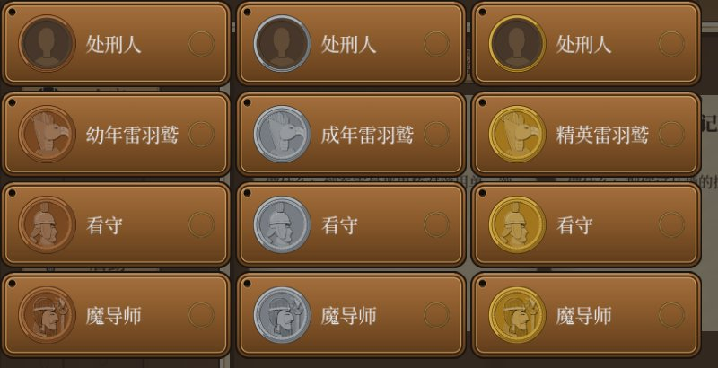
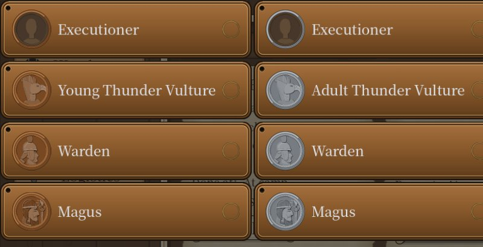

# 复测 v7.66–v7.69：处刑人、雷羽鹫调强、皮甲 3×2 正式图

- 日期：2026-11-22
- 版本：main `55c98d3`（v7.69，PR #822）。这一轮测的是 v7.66（#819，皮甲图）和 v7.69（#822，处刑人与雷羽鹫）。v7.67、v7.68 只改了文档。
- 结论：**全量测试、场景检查都通过，没有发现游戏问题。** 另有 2 处观察：处刑人还没有头像；处刑人身上偶尔出现「稀有」的随机物品。

## 一、全量测试与场景检查

- 全量测试：通过 45467 项断言、355 个套件，用时 903 秒；SCRIPT ERROR 0，EXIT 0。合并前报的 test_enemy_pool 失败已经没有了。
- 场景检查：`check_balance_scenarios --allow-dropped` 退出码 0。
  - 60 份流派木桩按同样的种子重造，和表一致。
  - 「合法 107 份，有问题 1 份（挡住 0 份）」。
- 皮甲（v7.66）：`i784.gd` 查到 `leather_armor` 和三种祝福版都有图（含 @2x），都放得进 3×3。

## 二、处刑人（v7.69）

用 `h822.gd` 无头检查。真开局在 A0 / A4 / A8 各跑 40 个种子，把每个战斗点、精英点都触发一遍，每档 466 场：

- **定义**：人形，不是魔兽；强度 3；生命 55；招牌是刽子手巨斧（史诗）。
- **出现的地方**：每档 6 次，**全部在精英点**，分布在 0、1、2 区，没有出现在普通战。和「只在核心环和内圈的精英点」一致。
- **带的东西**（A0 的 6 场）：
  - 每场都有刽子手巨斧和锁子甲，绷带卷 8 件。
  - 随机补的：皮袋、麻袋等包，药膏，伐木斧等。
  - 按稀有度数：普通 45、优良 27、稀有 7、史诗 6。史诗都是巨斧。稀有 7 件里，6 件是锁子甲（套装里写死的），只有 1 件不是：A0 一朵曼陀罗花，A4 和 A8 换成一块棱晶。
- **观察 1**：changelog 写「随机补的只取普通稀有度」，数据里是 `rarity_cap 1`（≤ 优良）。曼陀罗花和棱晶都是稀有，超出了这个上限。240 场处刑人里只各出现 1 件，影响很小。可能是别的规则（比如材料补位）放进来的，请落实线程确认是否有意。
- **名牌**：中文「处刑人」、英文「Executioner」。人形不加前缀，框按铜、银、金三档变。
- **观察 2**：处刑人**还没有头像**。名牌上是灰色剪影占位，三档都一样。要交美术线程。

## 三、雷羽鹫调强（v7.69）

- 定义：生命 85 → 110，耐力回复 8 → 12，招牌里的雷纹羽 3 → 4 根，和 changelog 一致。
- 实际出现（每档 3 次，都在精英点）：
  - A0：雷纹羽 13 根（3 场，平均 4.3 根，有的场多带一根随机补的）；传说 2 件。
  - A4、A8：雷纹羽 14 根；传说 6 件（v7.60 的「A4 起金档兽多带一件传说素材」也照常生效）。
- 名牌：三档分别叫「幼年 / 成年 / 精英雷羽鹫」，英文大字下是「Young / Adult / Elite Thunder Vulture」，名字都完整显示在名牌里，没有截断。

## 四、实机走查

- `e822.gd`（从 `e798.gd` 改）：在中文常规、英文大字两种设置下各跑一遍名牌墙。然后真开局到 A4，走到相邻的普通战，战前屏右边的对手是金框，肖像面朝左。
- 没有测到：在实机上真打一场处刑人或雷羽鹫。它们只在内圈和核心环的精英点出现，从出生点走过去太远。胜率「28%」这一条用的是合并时的套件结果，我没有单独复核。

## 五、脚本和日志

都在 [evidence/2026-11-22-v766-v769/](evidence/2026-11-22-v766-v769/)：`h822.gd`、`e822.gd` 和它们的日志，以及场景检查的输出。
