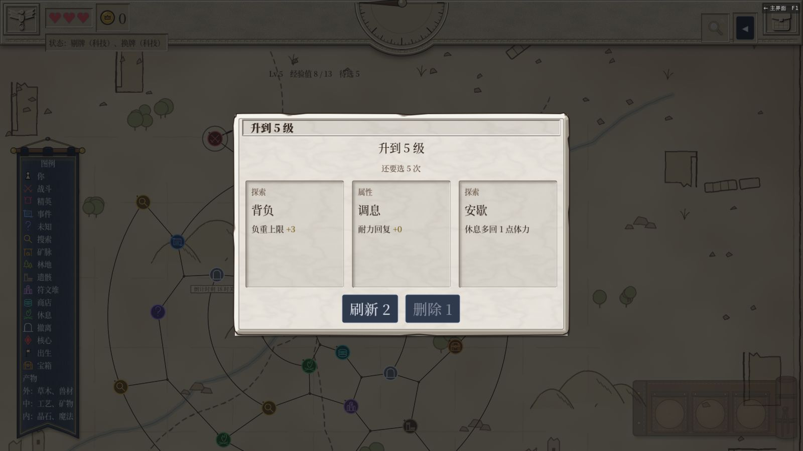
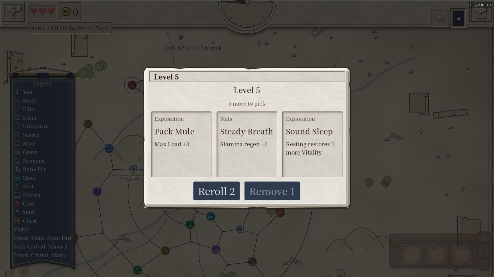
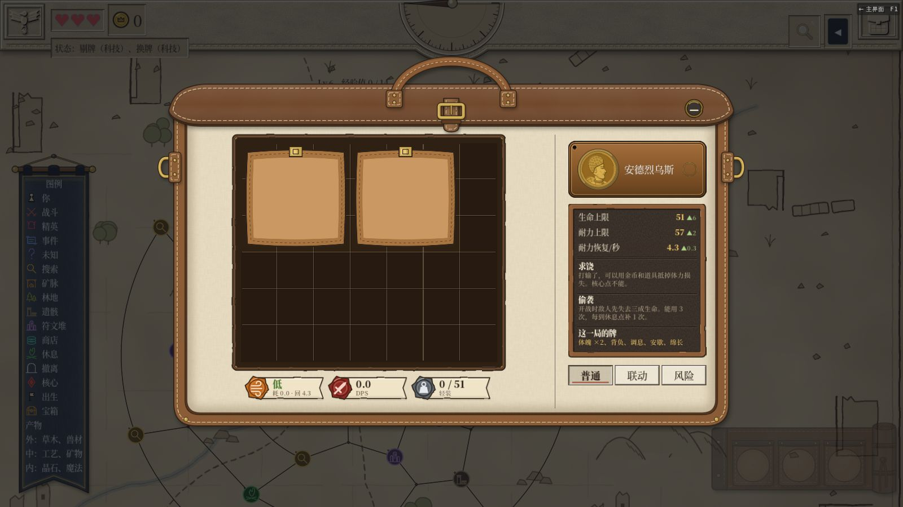

# 复测 v7.72：局内经验值、升级选牌、老存档迁移（报告 379）

- 日期：2026-11-22
- 版本：main `bddf5d6`（v7.72，PR #825）。
- 结论：**全量测试、场景检查都通过。** 升级选牌、换牌、剔牌、以人为本、经验值管、状态界面、存档往返和老存档迁移的主流程都走通了。
  - **发现 3 处问题**，都不挡玩：牌面数字取整、以人为本提示多出、老存档少一次以人为本。
  - 另有 2 处观察。

## 一、全量测试与场景检查

- 全量测试：通过 45567 项断言、355 个套件，用时 826 秒；SCRIPT ERROR 0，EXIT 0。
- 场景检查：退出码 0。60 份木桩重造后和表一致；「合法 107 份，有问题 1 份（挡住 0 份）」。

## 二、实机走查（`lv825.gd`，中文常规、英文大字各一遍）

1. 准备：新档，拒绝教程。测试辅助把科技「换牌」升到 2 级、「剔牌」升到 1 级。开局 A0，不奉神。
   - 进地图后：Lv.1，经验 0 / 9；换牌剩 2，剔牌剩 1；以人为本生效。
   - 经验值管写「Lv.1　经验值 0 / 9」。
2. 测试辅助加 50 点经验（A0 系数 1，实得 50）。升到 5 级，经验 8 / 13，欠选 5 次：2–5 级 4 次，加以人为本 1 次。地图上当场弹出选牌，三张牌不重样，写「还要选 5 次」，键是【刷新 2】【删除 1】。
3. 真点【刷新】：三张一起换了一批，刷新剩 1 次。
4. 真点【删除】：提示「再点一张牌删掉它：这一局不再出，空位补一张」。再点第 1 张，它被换掉，另外两张不变，删除剩 0 次。
5. 连着真点选完 5 次：每拿一张欠选减 1，同一张能叠（体魄 ×2），已有的牌写「已有 1 张」。第 5 次的提示是「以人为本：这一级再选一张」。选完后选牌窗收起。
6. 再升到 6 级，弹出选牌。按 Esc 收起，经验值管写「Lv.6　经验值 0 / 14　待选 1」。真点经验值管，选牌重新打开。
7. 状态界面：
   - 生命上限 51 ▲6（体魄 ×2）、耐力上限 57 ▲2（绵长 4%）、耐力恢复 4.3 ▲0.3（调息），加成写在数字旁边。
   - 负重 0 / 51（背负 +3）。
   - 最下面「这一局的牌：体魄 ×2、背负、调息、安歇、绵长」。
8. 存档退出再继续：等级、经验、欠选、刷新和删除剩余次数、拿过的牌都和存前一样。
9. **老存档 v7 → v8**：
   - 测试辅助把局存档改成 v7：版本号改成 7，删掉 `modules.level`，加上 `faith_progress`（日神信力 30、祈愿 25，蛮神 50 / 50），所奉的神设成日神。
   - 继续游戏，读档成功：经验值 = 日神信力 30 × 2 = 60，即 Lv.6、5 / 14，欠选 5 次，祈愿丢掉。
   - 回到地图后当场弹出选牌。

## 三、问题

1. **「调息」牌面写「耐力回复 +0」**（英文「Stamina regen +0」）。数据里是 +0.3，状态界面也确实加了 0.3，只是牌面上被取整成了 0。原因：`LevelModule.card_text` 用的是 `RunBuffDef.summary()`，它把小数取整了。
2. **以人为本的提示在不该出现的时候出现**。
   - 5 级拿完多出的那一次后，再升到 6 级只欠 1 次，提示仍然写「以人为本：这一级再选一张」。
   - 原因：`LevelPickPanel.rebuild` 用 `left <= bonus_picks` 判断，而 `bonus_picks` 是这一局累计的。所以以后每次只剩最后 1 次（10 级以后是最后 2 次）时都会显示这句。
3. **老存档迁移少一次以人为本**。
   - 迁移后的等级如果跨过了 5 的倍数（这次是 60 点 → 6 级），不奉神的玩家应该多选一次，实际只欠 5 次（2–6 级），少了 5 级那一次。
   - 原因：`restore()` 没有 `level_seen` 时就用当前等级，`_on_level` 不再触发，`bonus_picks` 停在 0。
   - 补充：这次脚本设了「奉日神」，但读档后 `is_humanist()` 仍是 true，也就是这一局按「不奉神」算。可能是脚本只改了 `faith_selection` 的写法不全，没进一步查。

## 四、观察

- 选牌窗的标题「升到 5 级」出现了两次：框的标题一次，面板里又一次。界面还是占位，等 UI 样张时一起看。
- 键上写「刷新」「删除」，科技和状态栏里叫「换牌」「剔牌」，叫法不统一。

## 五、没有测到

- 真打赢一场拿经验、走进更深一环拿经验、神坛祷告（每座 3 次、每次 5 点）：这一轮用测试辅助直接加经验，这几条来源靠单元测试 `test_level_372` 覆盖。
- 元素回响三张牌（要背包里有会施加元素的道具才出），这次抽牌没有抽到。
- 结算屏的「等级」一行。

## 六、脚本和日志

在 [evidence/2026-11-22-v772-levels/](evidence/2026-11-22-v772-levels/)。公共部分 `_head.gdh` 和跑法 `chain741.sh` 见 [evidence/2026-11-21-v731-v754/](evidence/2026-11-21-v731-v754/)。
