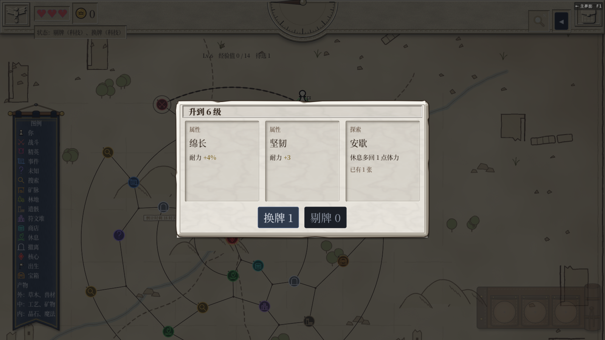
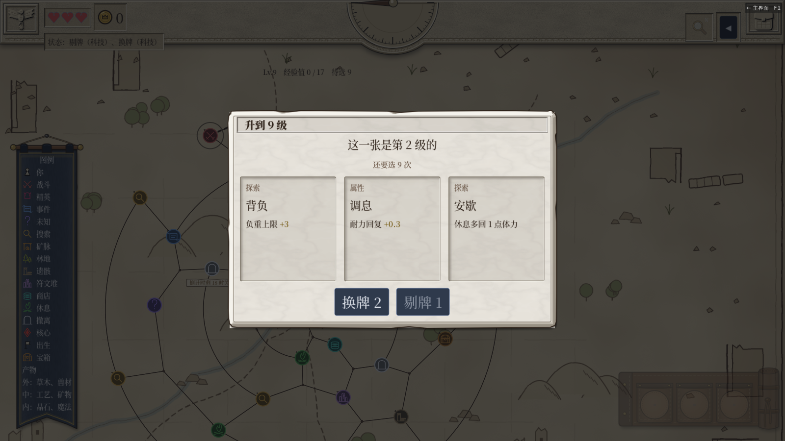

# 复测 v7.74：升级选牌 5 处修正

- 日期：2026-11-22
- 对象：v7.74（PR #827，提交 2d2f0f3），修 [v7.72 复测](2026-11-22-v772-levels-cards-migration.md) 报的 3 处问题，外加 2 处顺手改动
- 结论：**5 处都已修好。** 全量测试全过，场景检查退出码 0。另记 1 处低优先级的边角情况，供参考。

## 全量与场景检查

| 项目 | 结果 |
|---|---|
| `tools/test.sh` | 45575 项断言、355 个套件全过，耗时 875 s，EXIT 0，0 个 SCRIPT ERROR |
| `check_balance_scenarios --allow-dropped` | EXIT 0；60 个流派木桩重造后全部一样；合法 107 份，有问题 1 份（挡住 0 份） |

## 实机复测（xvfb，zh_normal 和 en_large 两套设置）

走查脚本还是 v7.72 那一份 `lv825.gd`，另加 `lv827h.gd` 走不奉神的老档。两份脚本都是 err=0。

| 复测项 | v7.72 的表现 | v7.74 的表现 | 结论 |
|---|---|---|---|
| 「调息」牌面 | 写「耐力回复 +0」 | 「耐力回复 +0.3」；英文是「Stamina regen +0.3」 | 已修 |
| 以人为本提示 | 5 级那次之后的最后一次也写「再选一张」 | 只在 5 级多给的那一次出现：「以人为本：这一级再选一张」（英文「Humans First: pick one more this level」）。6 级那一次不再出现 | 已修 |
| 选牌窗标题 | 只欠一次时，「升到 N 级」写了两遍 | 标题写「升到 5 级」，副标题写「这一张是第 N 级的」。只欠一次时只剩标题 | 已修 |
| 按键名字 | 「刷新 / 删除」 | 「换牌 2」「剔牌 1」；英文「Reroll 2」「Cull 1」。用掉以后数字跟着减 | 已修 |
| 老档迁移跨 5 级（不奉神） | 少给一次选牌 | 见下一节 | 已修 |

## 老存档 v7 → v8 迁移

两次都是先存一局，再用测试辅助把局存档改成 v7 的样子：版本改成 7，删掉 `modules.level`，`faith_progress` 写成日神信力 30、蛮神信力 50。

| 存档里的选择 | 读档结果 | 期望 | 结论 |
|---|---|---|---|
| 选日神 `selected_id: "sun"` | Lv.6，经验 5 / 14，欠选 5 次 | 30 × 2 = 60 点经验，就是 6 级余 5 点。奉神不多给，所以欠 5 次 | 对 |
| 不奉神 `selected_id: ""` | Lv.9，经验 0 / 17，欠选 9 次，回到地图就弹选牌 | 没奉神取信力最多的蛮神：50 × 2 = 100 点经验，正好 9 级。升过的 8 级加上 5 级多给的 1 次，共欠 9 次 | 对 |

`lv825` 日志里那句「应是 60 点经验：5 级、欠 4 次」是走查脚本自己的期望，写错了：60 点经验是 6 级，不是 5 级。游戏的行为是对的。

## 观察（低优先级，不算这次的问题）

迁移和游戏判断「以人为本」用的不是同一个依据：

- 迁移只看存档里的 `faith_selection.selected_id`。
- 游戏运行时看的是**有效信仰** `active_faith_id()`，也就是主信物要在棋盘上、而且有效。

所以，如果一份 v7 老档选了某位神，但那位神的主信物不在棋盘上，就会出现两边不一致：迁移不补 5 级的那一次，读档后游戏却按以人为本算，之后到 10 级照样会多给。

本轮走查日志里就是这种情况。测试档选了日神，但棋盘上没放日神信物，所以读档后显示「以人为本 true」。真实老档碰到这种情况应该很少，影响只是少给一次选牌，记在这里供参考。

## 测试工具问题

- `lv825` 的状态界面一步没抓到角色卡的文字。这是探针找节点的方式有问题，状态界面不在这次的复测范围，没有追查。
- 套件结尾的 `resources still in use at exit` 跟以前一样，是退出时的噪声，不影响结果。

## 证据

都在 [evidence/2026-11-22-v774-level-fixes/](evidence/2026-11-22-v774-level-fixes/)：

- 走查日志：`lv825-zh_normal.log`、`lv825-en_large.log`、`lv827h-zh_normal.log`
- 走查脚本：`lv827h.gd` 和 `_lv827h.body`。`lv825.gd` 见 v7.72 的证据目录；`lv827h` 只把老档改成不奉神，其余步骤相同
- `balance-2d2f0f3.log`、`suite-2d2f0f3-tail.log`
