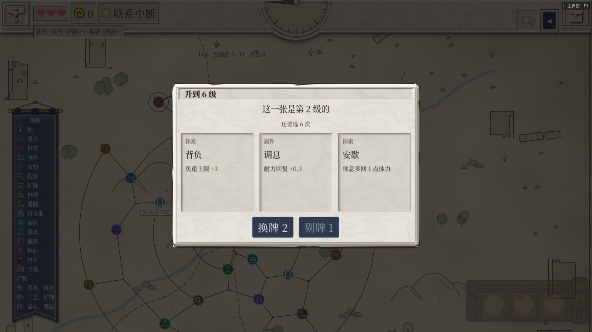

# 复测 v7.76：老档迁移按有效信仰补以人为本

- 日期：2026-11-22
- 对象：v7.76（PR #829，提交 86ff022）。修的是 [v7.74 复测](2026-11-22-v774-level-fixes-retest.md) 记下的边角情况。改法是迁移只在存档里标一句 `backfill_bonus`，读档装上等级模块时，再按棋盘上的有效信仰判断要不要补以人为本那几次。
- 结论：**已修好。** 选了神但信物不在棋盘上的老档，现在会补上 5 级那一次。补完再存档、再读，不会重复补。

## 全量测试与场景检查

| 项目 | 结果 |
|---|---|
| `tools/test.sh` | 45582 项断言、355 个套件全过，耗时 873 s，EXIT 0，0 个 SCRIPT ERROR |
| `check_balance_scenarios --allow-dropped` | EXIT 0；合法 107 份，有问题 1 份（挡住 0 份） |

## 实机复测（xvfb，zh_normal）

做法：先开一局正常存档，再用测试辅助把局存档改成 v7 的样子：

- 版本改成 7
- 删掉 `modules.level`
- `faith_progress` 写成日神信力 30、蛮神信力 50

然后继续游戏，读档后存档退出，再读一次。

| 老档 | 读档时的信仰 | 读档结果 | v7.74 时的结果 | 期望 | 结论 |
|---|---|---|---|---|---|
| 选了日神，棋盘上没有日神信物 | 所选「sun」，有效信仰为空 | Lv.6，经验 5 / 14，**欠选 6 次** | 欠选 5 次 | 60 点经验是 6 级，升过 5 次，加上 5 级多给的 1 次 | 已修 |
| 不奉神 | 所选为空，有效信仰为空 | Lv.9，经验 0 / 17，欠选 9 次 | 欠选 9 次 | 取信力最多的蛮神，100 点经验是 9 级，升过 8 次，加 1 次 | 对 |

两种老档再存档、再读回来，欠选次数都没变（6 次、9 次）。新存档的 `modules.level` 里也没有 `backfill_bonus`，说明补完就清掉了，不会重复补。

第三种情况是「选了神、信物也在棋盘上」，这种老档应该不补。实机走查没有摆信物，这种情况由单元测试 `test_level_372.gd` 的 `run_fixes_v773` 覆盖，它分别测了 none / missing / active 三种，而且检查了装两次不会重复补。全量测试里这一项是过的。

## 测试工具问题

无。走查脚本两份都是 err=0。

## 证据

都在 [evidence/2026-11-22-v776-legacy-backfill/](evidence/2026-11-22-v776-legacy-backfill/)：

- 走查日志：`lv825-zh_normal.log`、`lv827h-zh_normal.log`
- 走查脚本：`lv825.gd`、`lv827h.gd`，以及对应的 `.body`。比上一轮多了「老档再存档、再读」两步，读档那一行也记下了所选的神和有效信仰
- `balance-86ff022.log`、`suite-86ff022-tail.log`
