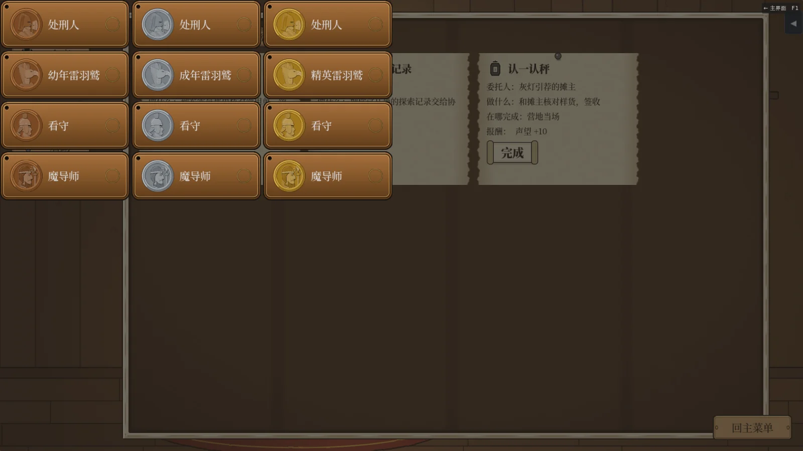

# 测试 v7.79：处刑人正式头像（浮雕）

- 日期：2026-11-22
- 对象：v7.79（PR #832，提交 7680b2b）。这次只加了 `assets/portraits/enemies/relief/executioner.png` 和它的 `.import`，其余都是文档。同一段时间还合并了 v7.78 和报告 377、378、380 的文档改动，也都只改文档。
- 结论：**处刑人头像已经接上，三档金属都显示正常。** 全量测试全过，场景检查退出码 0。

## 全量测试与场景检查

| 项目 | 结果 |
|---|---|
| `tools/test.sh` | 45582 项断言、355 个套件全过，耗时 767 s，EXIT 0，0 个 SCRIPT ERROR |
| `check_balance_scenarios --allow-dropped` | EXIT 0；合法 107 份，有问题 1 份（挡住 0 份） |

## 实机走查（xvfb，zh_normal）

用的是 v7.69 那份 `e822.gd`，没有改动（见 [evidence/2026-11-22-v766-v769/](evidence/2026-11-22-v766-v769/)）。

- **名牌墙：** 用游戏自己的 `Nameplate` 和 `enemy_layers` 画铜、银、金三档。处刑人三档的浮雕都读到了 `executioner.png`，底和框分别是对应金属的那一套。
- **对比上一轮：** v7.70 的报告里，处刑人还没有头像，名牌上是空的。现在图像居中，大小和其他敌人一致，三档金属的着色也都正常。
- **A4 开局：** 走到相邻普通战，战前屏名牌是金色，用的是对手自己的浮雕。这次地图上的相邻普通战是神射手，处刑人只出现在精英点。

## 测试工具问题

无。走查脚本 err=0。

## 未覆盖

- 实机没有打到一场处刑人精英战。处刑人在哪种点出现，上一轮已经用 h822 统计过，这次只换了图，没有重跑。

## 证据

都在 [evidence/2026-11-22-v779-executioner-relief/](evidence/2026-11-22-v779-executioner-relief/)：

- `e822-zh_normal.log`
- `balance-7680b2b.log`
- `suite-7680b2b-tail.log`
