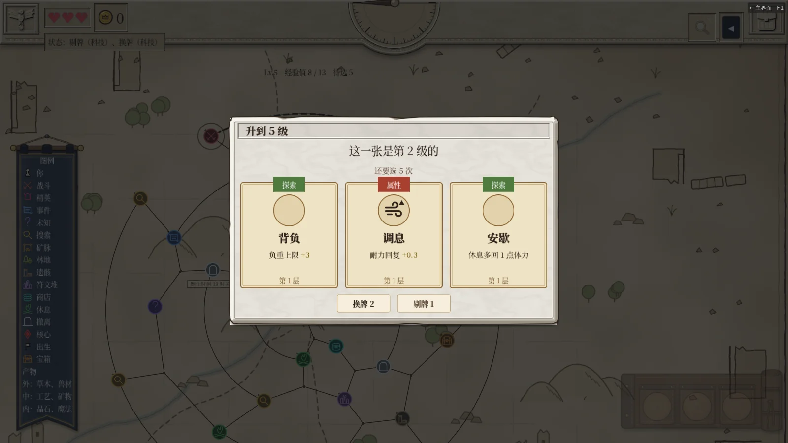
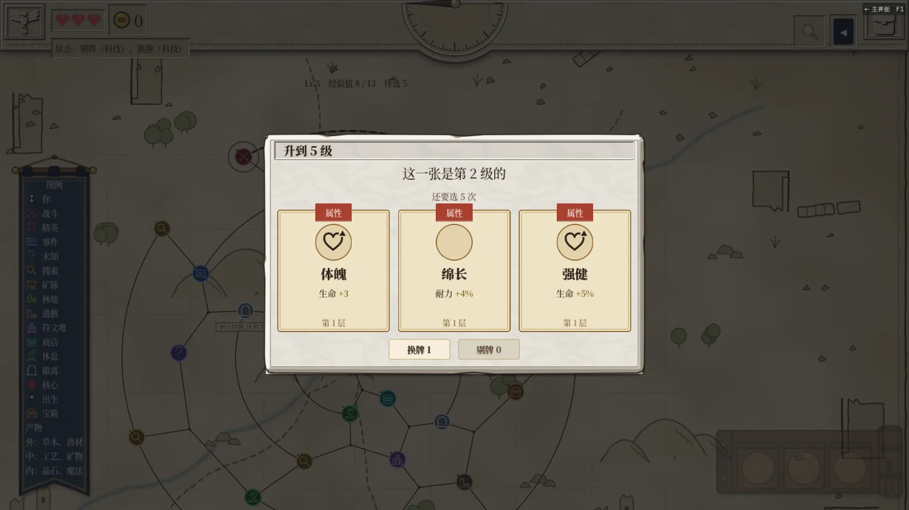
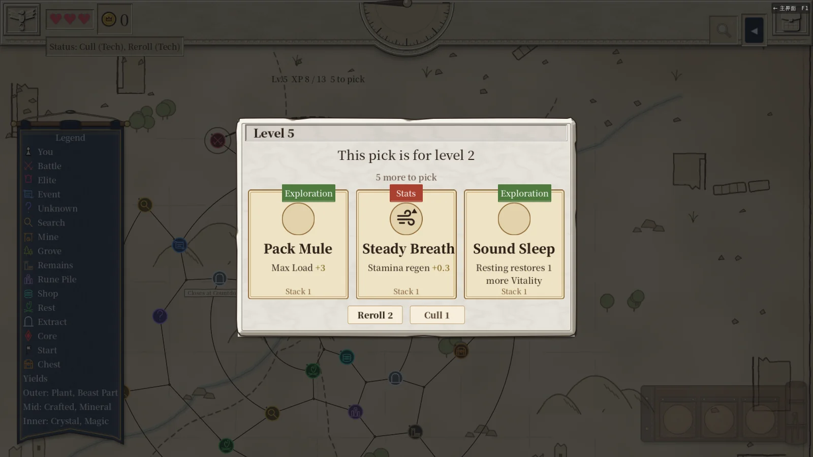

# 测试 v7.86：升级选牌窗换上 A 羊皮纸正式图

- 日期：2026-11-22
- 对象：v7.86（PR #839，提交 efb75b1）。牌面换成羊皮纸，上沿压类别条，中间是圆章，下面是牌名和效果，底部写「第 N 层」，「换牌 / 剔牌」换成平的浅底键。
- 结论：**功能都正常。** 选牌、换牌、剔牌、以人为本多给的一次、Esc 收起再点经验值管、存档往返、老档迁移，两套设置都走通。全量测试全过，场景检查退出码 0。
- 画面有 2 处问题：
  1. 15 张牌里有 12 张的圆章是空的。v7.88 已经画好这 12 个图标，但还没接进选牌窗。
  2. 英文大字号下，「Exploration」类别条被撑宽，偏到了牌的右边。

## 全量测试与场景检查

| 项目 | 结果 |
|---|---|
| `tools/test.sh` | 45582 项断言、355 个套件全过，耗时 761 s，EXIT 0，0 个 SCRIPT ERROR |
| `check_balance_scenarios --allow-dropped` | EXIT 0；合法 107 份，有问题 1 份（挡住 0 份） |

## 实机走查（xvfb，zh_normal 和 en_large）

走查脚本还是 `lv825.gd`，在 v7.77 那份的基础上没有改动。两套设置都是 err=0。各步结果和 v7.74、v7.76 的复测一致：

- 换牌、剔牌都按实际点击生效，次数跟着减。
- 以人为本多给的一次只在 5 级出现。
- 按 Esc 收起后，点经验值管能重新打开选牌窗。
- 存档往返后等级和欠选都对得上。
- 选了日神但信物不在棋盘上的老档，读回来是 6 级、欠选 6 次。

| 看什么 | 中文常规 | 英文大字号 |
|---|---|---|
| 羊皮纸牌面、圆章、牌名、效果 | 正常，居中，没有溢出 | 牌名「Steady Breath」刚好占满牌宽。「Sound Sleep」的效果折成两行，紧贴着「Stack 1」，但没有重叠 |
| 类别条（探索绿、属性红） | 居中压在上沿 | **「Exploration」把 72 px 宽的类别条撑宽，左边不动、往右长，所以偏到了牌的右侧**（见下图）。「Stats」正常 |
| 底部「第 N 层」 | 第一次拿写「第 1 层」，已有 1 张写「第 2 层」 | 「Stack 1」「Stack 2」 |
| 「换牌 / 剔牌」键 | 平的浅底，用完变灰：「剔牌 0」是灰底 | 同上 |
| 只欠一次时（没有副标题） | 类别条上沿贴着标题栏的下沿，没有压住 | 同左 |

## 实际游戏问题

1. **15 张牌里 12 张的圆章是空的。** 选牌窗只用每张牌第一条属性加成那根轴的图标（`effects/axis_<stat>_pos`）。现在只有「体魄」「强健」（生命）和「调息」（耐力回复）三张能找到图标，其余 12 张圆章是空圆。这 12 张是：
   - 探索：背负、安歇、耐行、细翻
   - 武器：省力、锋锐、迅捷、回响、回响·疾、回响·重
   - 属性：坚韧、绵长。这两张加的是耐力上限，没有对应的轴图标

   v7.88（美术线程）已经把这 12 个图标画在 `assets/ui/level/<牌 id>.png`，changelog 写明「接入由局内成长线程做」，只是还没接上。完整清单在 `icon839.log`。
2. **英文大字号下，「Exploration」类别条偏右。** 类别条的位置按 72 px 宽算好居中，但字比条宽，`PanelContainer` 往右长，结果偏离牌的中线大约 16 px。中文和「Stats」不受影响。改法可以是按实际宽度重新居中，或者给字设成可以缩小。

## 未覆盖

- 剔牌模式「开着」时，键上的提示只剩字色变深（以前是 `UiTheme.mark`），这次没有截到开着那一刻的图，没法判断够不够显眼。提示文字「再点一张牌剔掉它……」照常出现。
- 奉神时用的 `card_parchment_god` 底图代码里还没引用，现在只有「无信者」这一种牌面。

## 测试工具问题

无。

## 证据

都在 [evidence/2026-11-22-v786-pick-card-art/](evidence/2026-11-22-v786-pick-card-art/)：

- `lv825-zh_normal.log`、`lv825-en_large.log`
- `icon839.gd` 和 `icon839.log`：逐张牌查有没有图标
- `balance-efb75b1.log`、`suite-efb75b1-tail.log`
