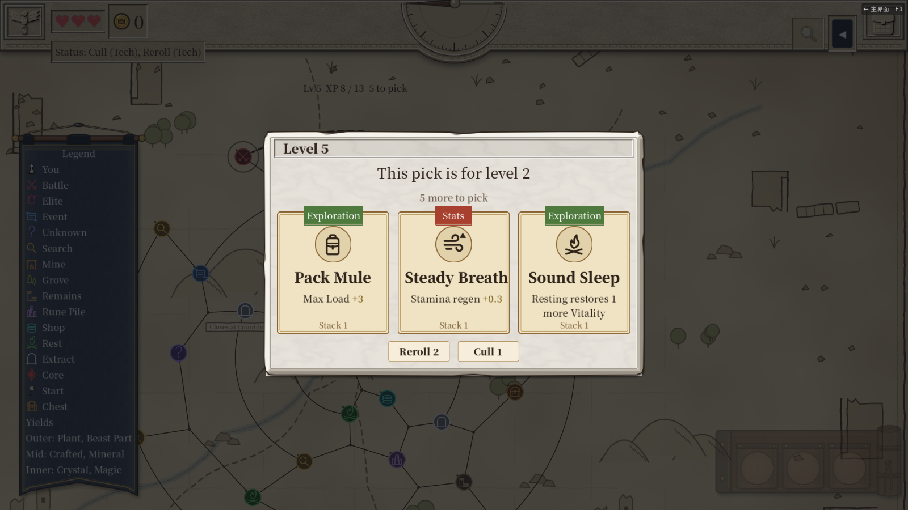
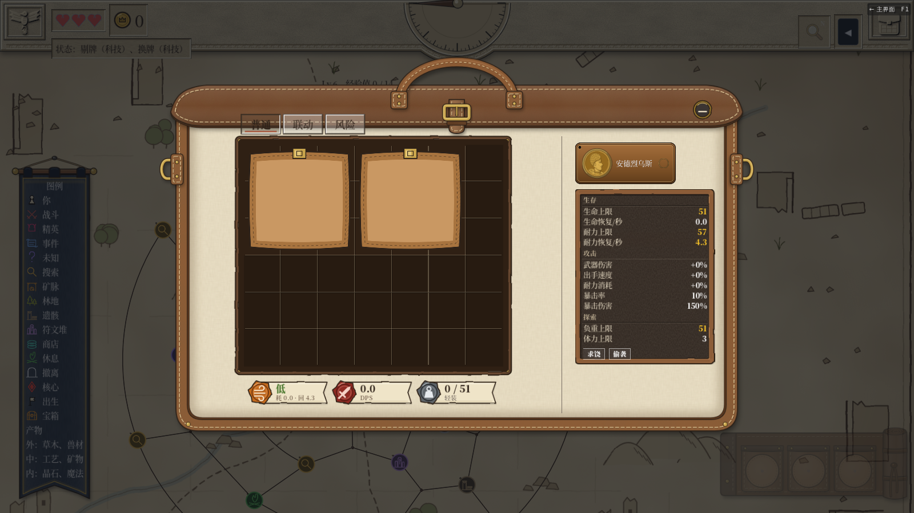
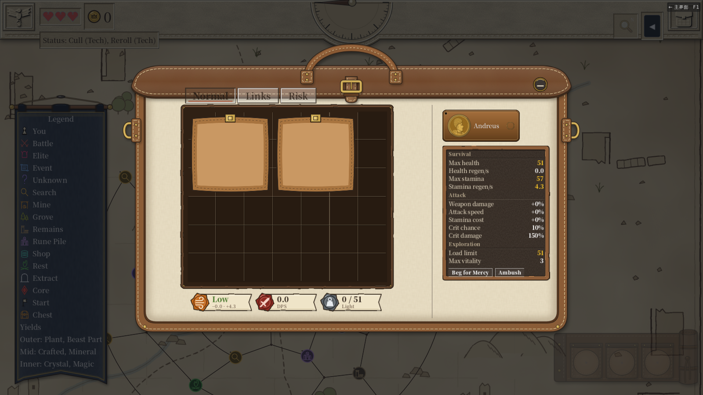

# 测试 v7.91 到 v7.93：守卫联动道具、万神院第一批、状态界面与选牌窗复测

- 日期：2026-11-22
- 对象：
  - v7.91（PR #844，99e665a）：守卫联动道具 6 件
  - v7.92（PR #845，1bcf749）：万神院第一批，报告 384
  - v7.93（PR #846，在 main 096e9bc 上测，含到 v7.98 的文档、素材和英文祷告签改动）：背包窗页签、状态界面全属性栏、无信者改名，以及复测 v7.90 报的两处
- 结论：三版全量测试都全过，场景检查都是退出码 0。
  - v7.91：6 件道具的定义都对，不出现在随机来源里。
  - v7.92：万神院的到来、选神、信物进包、信赖档、老档迁移都正常。**有 1 处问题：拒教程的新档仓库里留着两枚信物。** v8.00 删了序章三，可能顺带修掉，下一轮复测。
  - v7.93：v7.90 报的两处都修好了，状态界面全属性栏显示正常。

## 全量测试与场景检查

| 版本 | 提交 | `tools/test.sh` | `check_balance_scenarios` |
|---|---|---|---|
| v7.91 | 99e665a | 45664 项断言、355 个套件全过，887 s，0 个 SCRIPT ERROR | EXIT 0；合法 107 份，有问题 1 份（挡住 0 份） |
| v7.92 | 1bcf749 | 45749 项、356 个套件全过，889 s，0 个 SCRIPT ERROR | EXIT 0，同上 |
| v7.93 | 096e9bc | 45794 项、356 个套件全过，866 s，0 个 SCRIPT ERROR | EXIT 0，同上 |

## v7.91：守卫联动道具（无头探针 `g844.gd`）

| 道具 | 稀有度 | 格数 | 价值 | 说明 | 图 | 战斗规则 |
|---|---|---|---|---|---|---|
| 备用发条 / 失效版 | 史诗 | 2 | 150 / 150 | 中英都空 | 无，用占位 | 无 |
| 求援号角 / 失效版 | 史诗 | 2 | 150 / 150 | 中英都空 | 无，用占位 | 无 |
| 兽王之契 / 失效版 | 史诗 | 1 | 75 / 75 | 中英都空 | 无，用占位 | 无 |

- 6 件都带 `no_random_source`，不在随机候选 `ids()` 里，但图鉴 `ids(true)` 里列出来了。
- 在 A0、A4、A8、A12 各开 20 个种子的局，共 954 个点、240 场战斗。把每个点和每场战斗的内容整份扫一遍，6 件都没有出现。这符合 v7.91 的范围：v7.91 只入库，守卫携带和掉失效版要等 v7.99 接上。
- A12 在这一版还没有难度定义，探针按无难度开局。
- 留给作者看的一点：失效版和本体价值一样，卖价和炼化折价都相同。报告 366 定的是「失效版：能卖能炼的贵重品」，没写要不要打折。

## v7.92：万神院第一批（实机走查 `pt845.gd`，xvfb，zh_normal）

| 步骤 | 结果 |
|---|---|
| 新档拒教程进营地 | 万神院没来；后勤只有「集市」「铁匠铺」；这份存档没有信仰 |
| 真点【开始探索】（前三局） | 直接进开局屏，没有选神这一步 |
| 前三局开局 | 这一局没有信仰、没有赐福；背包里没有信物；图上没有无名祭坛 |
| 走一步后撤离（测试辅助 `force_extract`），结算屏【继续】 | 成功撤离计数 1 → 2 → 3。第 1 局后制图协会和苗圃来营地，第 3 局后万神院来营地 |
| 第 3 局回营地 | 万神院的牌子亮起：徽、「万神院」、一段说明、【知道了】。点了以后通知消失；后勤多出「万神院」小键 |
| 后勤「万神院」页 | 信赖菱点 ◆◇◇◇◇；蛮神、技巧之神、日神亮着，另外三张写「？？？？」。排版没有溢出 |
| 真点【开始探索】 | 弹出选神界面「这一局奉哪位神」：无信者在第一项，蛮神、技巧之神、日神可以选，另外三位写「？？？？」，键是灰的「信赖 2」。排版没有溢出 |
| 点灰着的狩猎之神 | 没反应，界面还在 |
| 真点日神 | 进开局屏，再进地图。这一局奉日神，有效信仰也是日神；背包里有 `charm_sun`；图上铺了无名祭坛；一档没有赐福、没有经验加成；「奉过」记下了日神 |
| 测试辅助把信赖补到 10、25、50 | 档位依次是二、三、四档。二档起六位神都能选；三档有经验 +10%；四档有赐福 |
| 存档退出再继续 | 奉日神、信物、无名祭坛都读回来了 |
| 这一局撤离 | 仓库里信物的数量没有变多：日神信物没有带回来。但仓库里原本就有两枚信物，见下面的问题 |
| 老档迁移（测试辅助：清掉迁移标记、万神院改成没来、仓库放一枚蛮神信物、对局记录加一行奉过狩猎之神，然后重开存档位） | 万神院算已到来，在一档；奉过的神是狩猎之神和日神，所以一档也能选狩猎之神；仓库里 3 枚信物折成 600 金币；迁移记录 1 条。再开一次不会重复迁移，金币不变 |

### 实际游戏问题

1. **拒教程的新档，仓库里留着蛮神、日神两枚信物，还记了 `prologue3_done`。**
   - 原因：拒教程照旧发序章三的教程奖励 `tutorial_items`（charm_brute、charm_sun）。
   - 新档建档时已经标过迁移，不会走老档那套「信物折钱」，所以这两枚会一直留在仓库。万神院来了以后，出征时会另发一枚信物，仓库里这两枚就成了多余的东西。
   - 万神院来之前，玩家也能把它们手动带进没有信仰的局。这条没有实测。
   - v8.00 删了序章三，可能顺带修掉，下一轮复测。
   - 无头直接调 `decline_tutorial()` 不会发这两枚，只有从营地界面拒教程才会，所以单元测试测不出来。
2. **小处**：到来通知的说明写「不选就是无信者」，但选神界面没有「不选」，【无信者】本身就是一个选项。

## v7.93：背包窗、状态界面、选牌窗复测（`lv825.gd`，zh_normal 和 en_large）

- **选牌窗图标：** 15 张牌全部有图标（`icon839.gd` 查出 15 张、空圆章 0 张）。背负、安歇等探索牌也换上了图。
- **英文类别条：** 「Exploration」撑宽以后仍然居中，v7.90 报的偏右问题修好了。
- **状态界面：**
  - 【普通】【联动】【风险】三个小页签挪到了棋盘框左上角。
  - 右边是全属性栏，分生存、攻击、探索三组。有加成的数是金黄色（这一局拿了牌：生命上限 51、耐力上限 57、负重上限 51），没有加成的是白字。
  - 两套设置都没有溢出。
- **小处：** 英文大字号下，当前页签的红色下划线压在「Normal」字的中间，看起来像删除线。中文也压到了「普通」的下沿。
- **其余流程：** 和 v7.86 那一轮一致，换牌、剔牌、无信者多给的一次、存档往返、老档迁移都正常。

## 未覆盖

- 状态界面属性的悬浮窗「N + M + Q%」：这次没有做悬停。
- 四档「赐福」在神坛上的实际选项，以及三档 +10% 经验的实际数值：只查了服务开关和 access，没有在局里实测。
- 万神院委托（《初次奉神》等）的进度。
- 剔牌模式「开着」时键染暖色：没有截到那一刻的图。

## 测试工具问题

- `pt845` 第一次跑时，走到相邻的战斗点后卡在战前屏：探针的 `_settle` 不处理战前屏。改成优先走非战斗点，并且在战前屏也直接撤离，第二次跑通，err=0。

## 证据

都在 [evidence/2026-11-22-v791-v793-pantheon/](evidence/2026-11-22-v791-v793-pantheon/)：

- 探针：`g844.gd`、`pt845.gd`（`_pt845.body` 加上 v7.31 那一轮的 `_head.gdh`）
- 日志：`g844.log`、`pt845-zh_normal.log`、`lv825-*-v793.log`、`icon-v793.log`
- 三版的 `suite-*-tail.log`、`balance-*.log`
