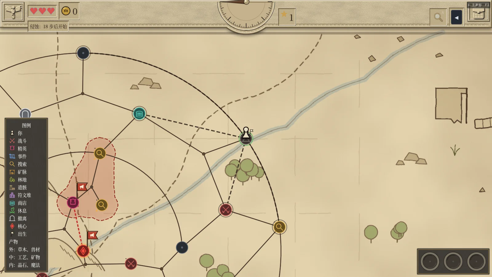
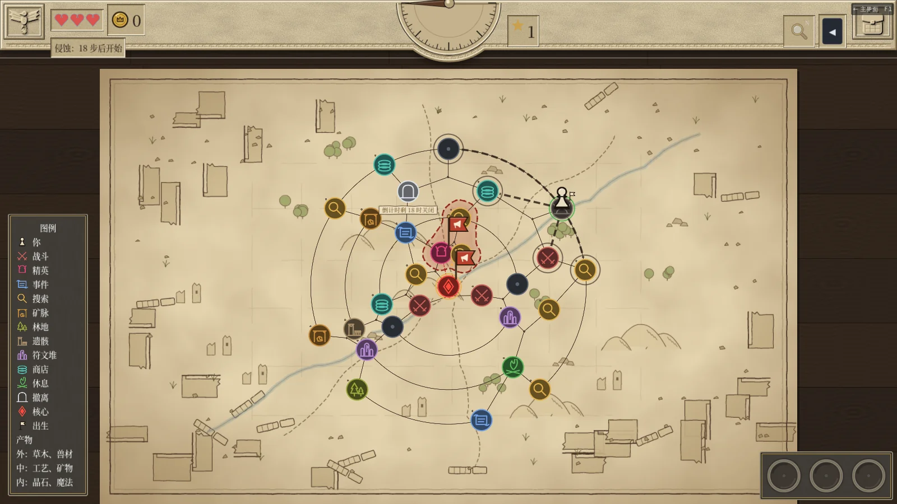
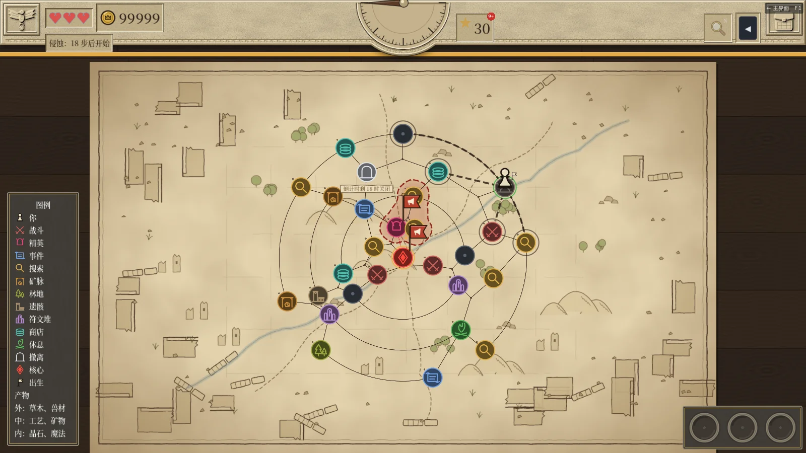
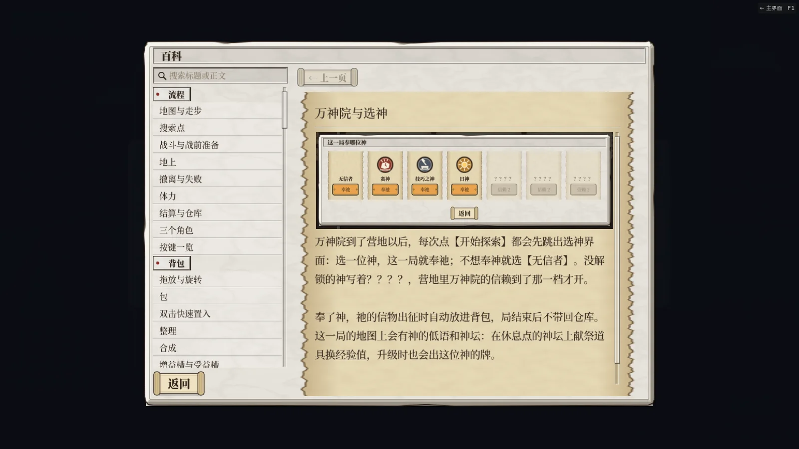
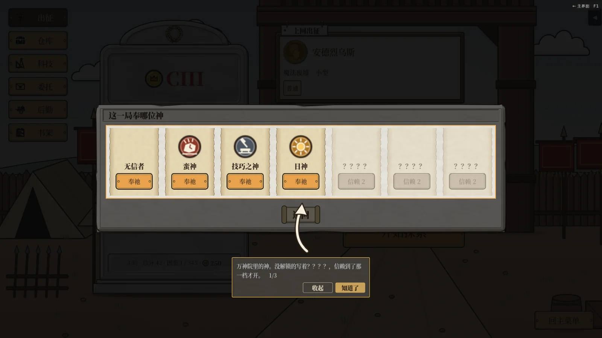
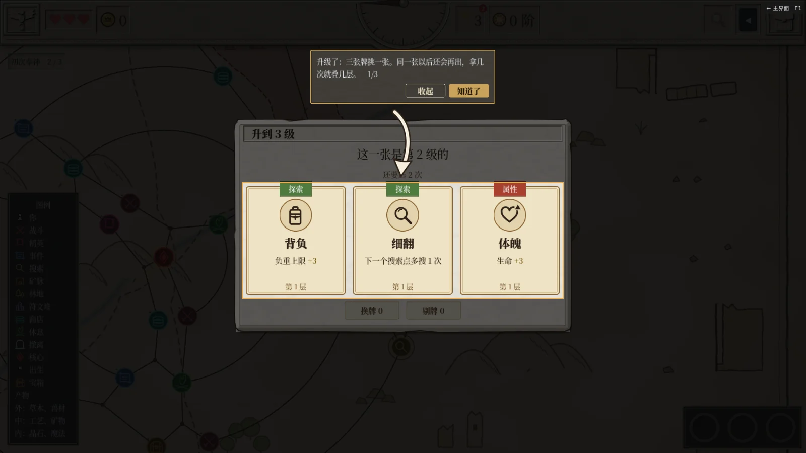

# 测试 v7.99 到 v8.03：A12 守卫核心、万神院第二批、地图放大与守卫小旗、顶端栏

- 日期：2026-11-23
- 对象：
  - v7.99（PR #852）：A12 守卫核心
  - v8.00（PR #853）：万神院第二批，报告 386
  - v8.02（PR #855）：守卫小旗、守卫到首领的红色虚线、地图放大
  - v8.03（PR #856）：局内石刻风格、顶端栏成长区、经验值条
- 测在哪个提交上：
  - 全量测试和场景检查跑在 b18f14a 上，包含 v7.99 和 v8.00。
  - 实机走查跑在 4dd5913（v8.03）上。
  - v8.02 和 v8.03 的全量测试没有单独跑，并到下一轮 v8.04 那次一起跑。v8.04 已经合并，改了出征流程。
- 结论：
  - **A12 守卫：** 机制正常。
  - **万神院第二批：** v8.01 报的「拒教程留下两枚信物」已经修好。第一次选神的百科页和教练层、第一次升级的教练层都正常。
  - **v8.02 地图：** 开局视图没有越界，也没有重叠。缩到最小时，小旗会压住相邻的节点。
  - **v8.03 顶端栏：** 满载（30 级、99999 金币）时没有溢出。
  - 另有 3 处小问题，见下文。

## 全量测试与场景检查（b18f14a）

| 项目 | 结果 |
|---|---|
| `tools/test.sh` | 45211 项断言、356 个套件全过，856 s，EXIT 0，0 个 SCRIPT ERROR。比上一轮少了 583 项，因为序章三的套件随整章一起删了 |
| `check_balance_scenarios --allow-dropped` | EXIT 0；合法 107 份，有问题 1 份（挡住 0 份） |

## v7.99：A12 守卫核心（无头探针 `q852.gd`，真开局 A11、A12 各 40 局）

| 项目 | A11 | A12 |
|---|---|---|
| 有守卫的局 | 0 | 40（每局正好一名） |
| 守卫绕得开 | — | 40 |
| 首领带增援 | 0 | 40；没有出现「没守卫但首领带增援」的局 |
| 守卫是谁 | — | 21 种精英，最多的是 adept_mage、witch_doctor 各 4 次，都是精英点 |
| 带的联动道具 | — | 求援号角 34 次，兽王之契 6 次，**备用发条 0 次** |

- 种子 26 的守卫浮窗写：「守卫：带着【求援号角】，打倒它，首领的增援就撤掉」。首领浮窗写：「守卫增援：【求援号角】」。
- 走一遍打赢守卫的结算（`_guard_won`）：掉了 `rally_horn_spent`，首领的增援撤掉了，首领浮窗也不再写增援。
- 备用发条一次也没出现，原因是它只配给机关池，这一章（free_mode）的守卫用不到机关池。
- 实机打赢守卫这一步没有做：玩家开局的装备打不过精英，结算是直接调函数做的，和单元测试一样。

**说明文字和实际不一致（请作者看一下）：** A12 的说明写「打倒守卫增援就撤掉，**还能拿到一件保底的传说**」。实际上打赢守卫掉的是失效版，失效版的稀有度是史诗。changelog 写的「精英额外一件传说」是所有精英都有，不是守卫独有。按现在的写法，玩家会以为守卫额外保底一件传说。

## v8.02：地图放大、守卫小旗、红色虚线（实机 `m855.gd`，A12，zh_normal）

- 游戏画面按 1777 × 1000 的设计尺寸整体缩放。窗口分别设成 1280×720、1366×768、1600×900、1920×1080，地图视口都还是 1777 × 1000，排版完全一样，不会因为分辨率不同而越界。
- **开局视图（缩放 1.23）：** 节点之间没有重叠，小旗没有压到别的节点。守卫精英和首领各插一面号角旗，红色虚线是直线连起来的。有 15 个节点在视口外，要拖动地图才能看到，这是正常的。
- **缩到最小（缩放 0.47，整张纸都装进来）：** 节点按固定的屏幕大小画，24、25 两个点的圆心只隔 40 px，半径是 21 px，两个圆叠在一起。守卫那面旗压住了相邻的节点 18 和 25，首领那面旗也压住了节点 25。截图里能看到，守卫旁边的搜索点被旗挡住了一半。
- 图例那块板一直压在地图左侧，以前就这样。

## v8.03：顶端栏满载（实机 `m855.gd`）

测试辅助把经验加到 30 级（欠 35 次选牌），钱包加到 99999。顶端栏显示「99999」「30」，等级星右上角是红点「9+」，下面是全屏宽的金色经验值条。27 处文字都没有溢出。

英文大字号那次走查没有跑完：后台任务被中断，日志只有第一行。所以英文顶端栏这次没有验证，并到下一轮。

## v8.00：万神院第二批（实机 `pt853.gd`，在 pt845 的基础上加了两个教练层，zh_normal）

| 项目 | 结果 |
|---|---|
| 拒教程的新档 | 金币 250，仓库里没有信物，`prologue3_done` 是 false。**v8.01 报的问题已修好** |
| 万神院来之前的百科 | 神、祭坛、万神院那几页都藏起来了。**但还剩两页：「信物与右键」（anchor_and_right_click）和「信力与档位」（faith_power_and_tiers）。** changelog 写的是「不列神、信物、祭坛那几页」，这两页是不是也该藏，请确认 |
| 第 3 次撤离后 | 万神院到来，百科多出 9 页，包括 `pantheon_choose` 和六位神 |
| 第一次点【开始探索】 | 先翻开百科的「万神院与选神」页，页里带选神界面的截图。合上以后，教练层走三步：？？？？ 和信赖、无信者、【奉祂】 |
| 第一次升级（奉日神，测试辅助加 20 点经验到 3 级） | 选牌窗上的教练层走三步：三选一和叠层、换牌、剔牌 |
| 其余 | 和 v7.92 一致：选神、信物进包、信物不带回仓库、信赖档、老档迁移（这次仓库里只有 1 枚信物，折成 200 金币）、不会重复迁移 |

小处：

1. 新档没点换牌、剔牌的科技时，两个键是灰的「换牌 0」「剔牌 0」，但升级教练层的第 2、3 步照样在讲换牌和剔牌。
2. 升级教练层的箭头压在副标题「这一张是第 2 级的」上。

v8.04 把选神弹窗删了，并进了出征第一屏。上面测的选神界面和选神教练层，下一轮要按新流程重测。

## 未覆盖

- 实机打赢守卫、首领的增援在战斗里怎么生效：单元测试 `run_reinforce_battle` 覆盖了。
- 英文大字号的地图和顶端栏。
- 帮助页截图工具 `tools/help_shots.gd` 生成的英文那一套截图。

## 测试工具问题

- m855 英文大字号那一轮没有跑完：后台任务被中断，日志只有一行。
- m855 在各种窗口大小下截图时，「开局视图」用的是上一轮 fit 之后留下的缩放。所以只有第一张（1280×720）是真正的开局视图，后面三张都是缩到最小的视图。

## 证据

都在 [evidence/2026-11-23-v799-v803-a12-pantheon2-map/](evidence/2026-11-23-v799-v803-a12-pantheon2-map/)：

- `q852.gd` 和 `q852.log`
- `m855.gd` 和 `m855-zh_normal.log`
- `pt853.gd` 和 `pt853-zh_normal.log`
- `suite-b18f14a-tail.log`、`balance-b18f14a.log`
