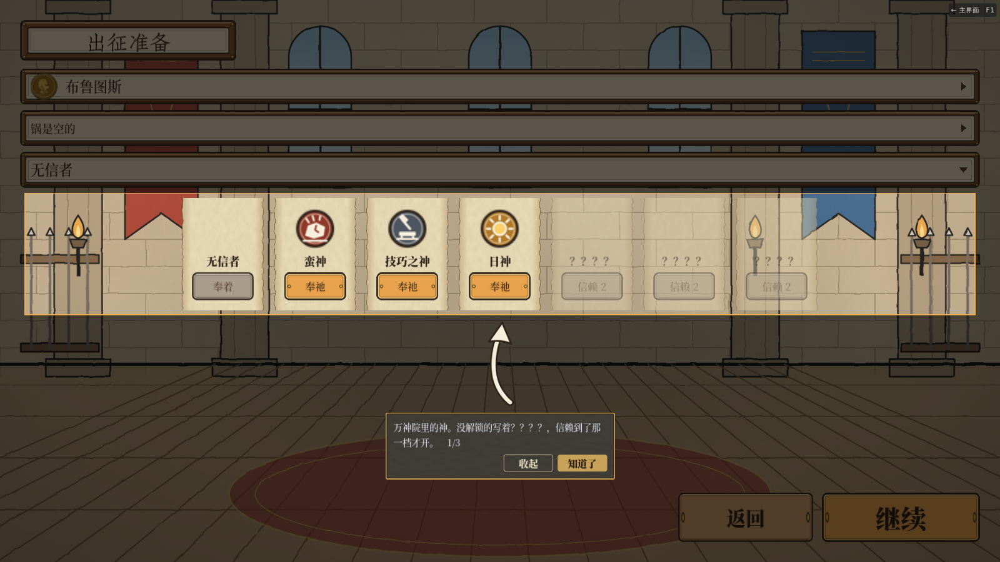
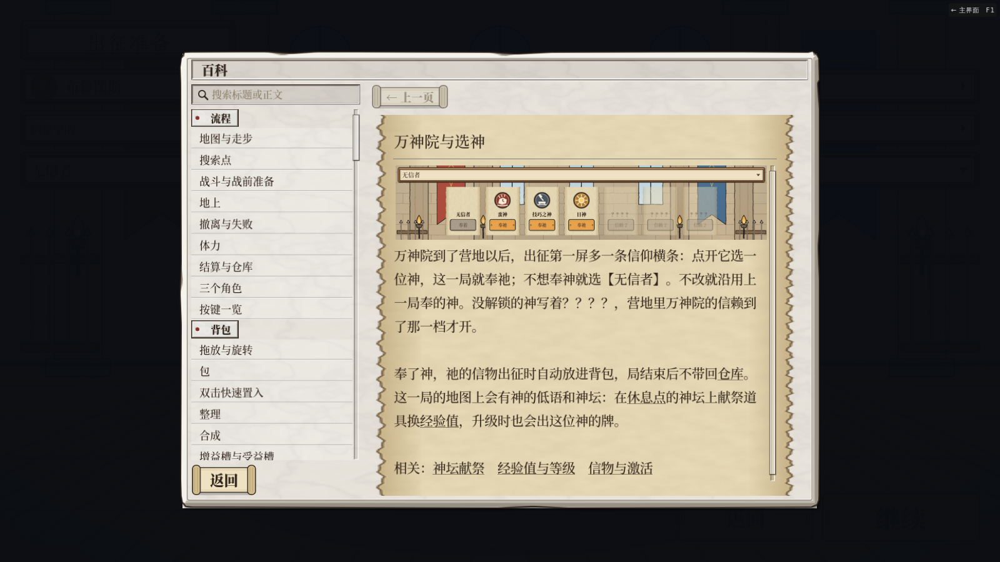
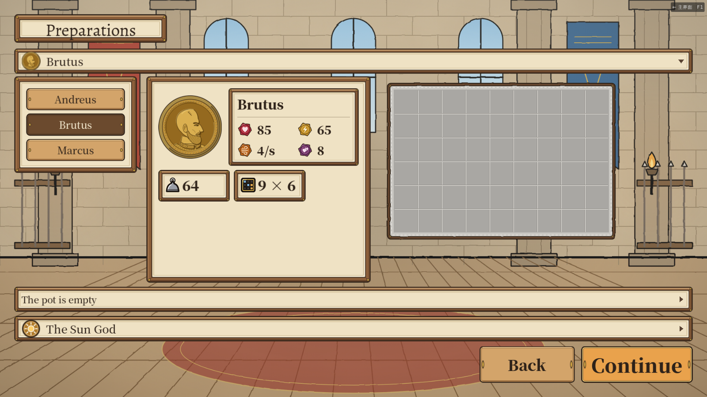
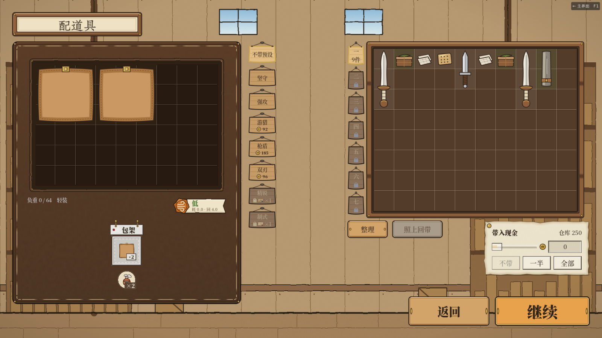
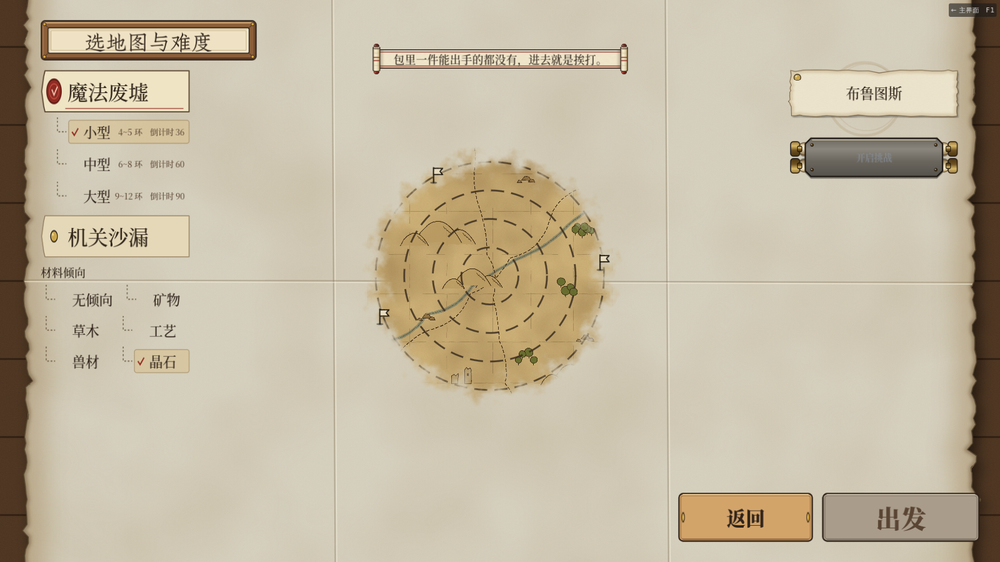
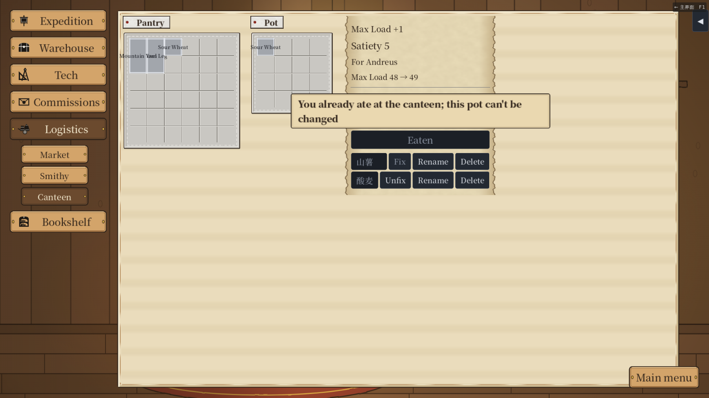
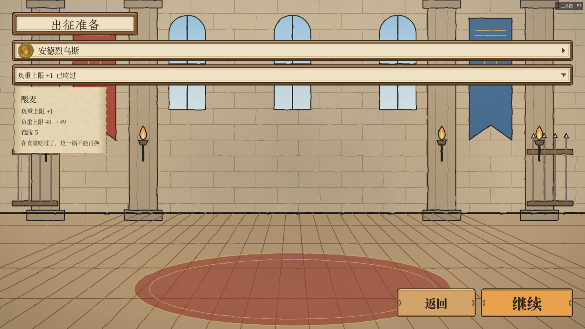

# 测试 v8.04 到 v8.07：出征三屏、守卫小旗缩放、食堂固定配方与开饭

- 日期：2026-11-23
- 对象：main 68d1750，含三次合并：
  - v8.04（PR #857）：出征三屏、折叠横条、删军需牌和选神弹窗、首次信仰条教练层
  - v8.06（PR #859）：守卫小旗随缩放变小
  - v8.07（PR #860）：食堂【固定】配方和【开饭】
- 结论：**三项都正常，没有发现游戏问题。**
  - 出征从基地到出发都是三屏。三条横条默认折叠，同时只展开一条，展开哪条都放得下。
  - 配道具页有随身技能圆槽。
  - 第三屏能选材料倾向，下回沿用。
  - 第一次展开信仰条：先翻开百科，再放教练层。
  - 食堂【固定】【开饭】从食堂到出征整条走通，旧存档读回来算没设、没吃。
  - 缩到最小时守卫小旗缩到 0.4～0.55 倍，不再压住节点。

## 全量测试与场景检查

| 项目 | 结果 |
|---|---|
| `tools/test.sh` | 45301 项断言、357 个套件全过，耗时 800 s，EXIT 0，0 个 SCRIPT ERROR |
| `check_balance_scenarios --allow-dropped` | EXIT 0；60 个流派木桩重造后完全一样；合法 107 份，有问题 1 份（挡住 0 份） |

v8.04 起，测试器的 frame_ 用例改成一帧只跑一个套件。这一轮全套正常跑完，退出码 0，没有出现退出时崩溃（134）。

## 出征三屏（v8.04）

走查脚本 `dp857`，中文常规和英文大字号各跑一遍，两遍都是 err=0。走查从新档开始，点按键都是真点。

| 检查项 | 结果 |
|---|---|
| 基地出征页 | 没有军需牌。点【开始探索】直接进开局屏，没有选神弹窗 |
| 页数、标题 | 3 页：「出征准备」「配道具」「选地图与难度」，最后一页的键是「出发」 |
| 新档第一屏 | 只有角色一条，默认折叠，头上是头像和角色名。食物条和信仰条都不出 |
| 展开角色条 | 是原来的三栏。横条一栏高 738，可用高度也是 738，正好放下。换角色后头上的名字跟着变 |
| 回车 | 翻到下一页 |
| 万神院到来、开了食堂以后 | 三条都在。首次出征时信仰条自己展开，食物条写「锅是空的」 |
| 首次展开信仰条 | 先翻开百科「万神院与选神」，内容是新写法（出征第一屏多一条信仰横条……）。翻书时按回车不翻页，按 Esc 合上书，接着放教练层，共 3 步。教练层开着时按回车也不翻页 |
| 神龛 | 依次是：无信者（写「奉着」，灰）、蛮神 / 技巧之神 / 日神（「奉祂」），其余三位灰着写「信赖 2」。点灰的狩猎之神没有反应。点日神后头上写「日神」，键变「奉着」 |
| 同时只展开一条 | 展开食物条时，信仰条自己收起。轮流展开三条都放得下，各条都没有溢出 |
| 配道具页 | 测试辅助发了 2 枚烟雾弹，页面上有 1 个随身技能圆槽，写 ×2，有图标，看得见 |
| 第三屏材料倾向 | 测试辅助开了倾向后，地图列表下面出现两列小签，共 6 个方向。真点「晶石」，下次进开局屏还是「晶石」 |
| 出发 | 奉日神，日神信物在背包里，有效信仰是日神 |
| 再进开局屏 | 三条都折叠，头上写布鲁图斯 / 锅是空的 / 日神。不再翻百科，也不再放教练层，角色沿用上回的 |

## 守卫小旗缩放（v8.06）

走查脚本 `m855`：解锁进阶到 12 级，在 4 种窗口尺寸下各看开局视图和缩到最小后的样子。脚本这次按 `guard_flag_scale()` 算旗子的实际大小。

| 设置 | 开局视图 | 缩到最小（0.47） |
|---|---|---|
| 中文常规 | 旗 1.00 倍，不压节点 | 旗 0.55 倍，不压节点（上一轮压 3 处） |
| 英文大字号 | 旗 1.00 倍，不压节点 | 旗 0.41 倍。脚本只报核心旗的矩形擦到旁边战斗点的圆边，截图上旗尖贴着圆边，没有盖住图标 |

顶端栏满载（30 级、99999 金币）中英两套都没有溢出。上一轮欠的英文大字号这次补上了。

## 食堂固定配方与开饭（v8.07）

走查脚本 `ct860`，中英两套都是 err=0。准备工作用测试辅助：开食堂，存两份收藏「山薯」「酸麦」，锅里另放一个山薯。之后的按键都是真点。

| 步骤 | 结果 |
|---|---|
| 没设固定配方就进开局屏 | 锅里的山薯退回食材仓库，食物条写「锅是空的」。展开能看到两份收藏 |
| 食堂页 | 每份收藏一颗【固定】。锅空时【开饭】是灰的，悬停写「锅是空的」 |
| 点第二份的【固定】 | 固定 = 第二份，键变【取消固定】 |
| 再点第一份 | 固定换成第一份，同一时间只有一份 |
| 再点一次 | 取消固定 |
| 设回「酸麦」后进开局屏 | 锅按酸麦配好，食物条写「负重上限 +1」。展开能换，酸麦那颗的悬停里有「固定配方」 |
| 食堂页点【开饭】 | 键变「已吃过」并灰掉，收藏的重做键也灰了，锅退出拖拽层 |
| 重开存档位 | 「固定 1、吃过 true」都还在 |
| 吃过后进开局屏 | 头上写「负重上限 +1 已吃过」。展开只能看，下面写「在食堂吃过了，这一锅不能再换」，没有收藏键。测试辅助硬换第一份也换不了 |
| 出发 | 吃的就是这一锅。锅空了，吃过的标记清掉，固定配方留着 |
| 旧档 | 测试辅助把存档里的 `fixed`、`eaten` 两项删掉再读回：固定 -1、吃过 false。进开局屏是空锅 |

## 观察（低优先级，不算问题）

- **出发后锅名还在。** 出发吃掉这一锅后，锅空了，但 `menu_name()` 还是「酸麦」（`active` 没清）。下次进开局屏时，有固定配方就照它重配，没有就清空，所以玩家应该看不出来。只是食堂页在这段时间里可能显示「酸麦 缺 1 格」，这次没截到图。
- **吃过以后【固定】还能点。** 这时改固定配方只影响下一锅，不影响已经吃下的这一锅，行为没错。
- **第一屏还是占位排版。** 食物条头上没有图标，信仰条头上有神的徽记，这和落地记录写的遗留一致。

## 测试工具问题

- `dp857` 第一版在 `_process` 里用了 `await`，脚本在「点日神」之后提前退出。改成分状态以后重跑通过。
- `ct860` 第一版有一个类型推断的解析错误，改了重跑通过。
- 第三屏的排版检查报「溢出 2」，两处都是倾向区里的空字标签，不是看得见的东西。
- 「真点倾向后立刻读选中值」读到的是空的，因为点击事件下一帧才处理。下次进开局屏读到的「晶石」证明点击生效了。
- 局里材料倾向那一栏，脚本读的字段名不对，显示「-」。这和游戏无关。

## 证据

都在 [evidence/2026-11-23-v804-v807-departure-canteen/](evidence/2026-11-23-v804-v807-departure-canteen/)：

- 走查日志：`dp857-*.log`、`ct860-*.log`、`m855-*.log`（中文常规和英文大字号各一份）
- 走查脚本：`dp857.gd`、`ct860.gd`、`m855.gd`，以及对应的 `_*.body`
- `suite-68d1750-tail.log`、`balance-68d1750.log`
