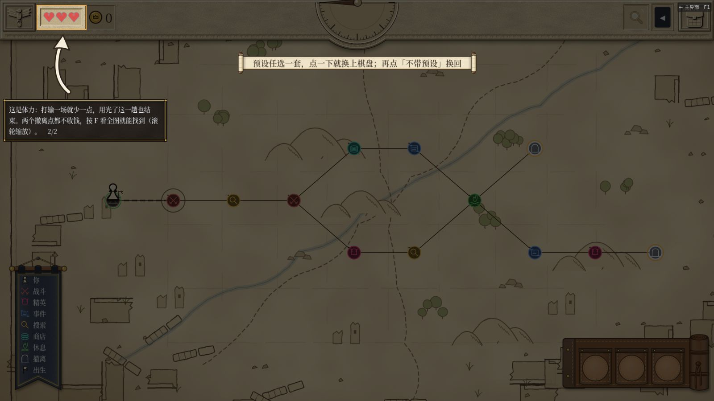
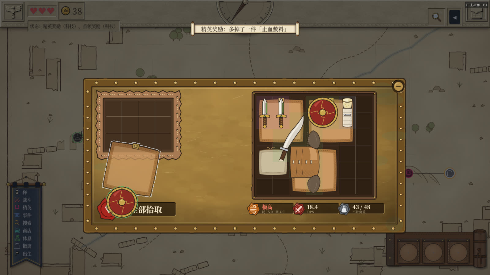
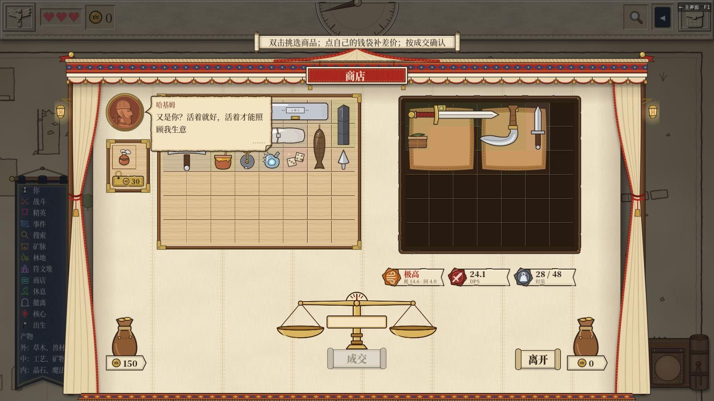

# 局内主界面优化方案与实例排版

日期：2026-11-19

基线：`0a95b7b8`（main，信仰方案 PR #663 已合并）

状态：供 Claude 接手的规划文档，未修改游戏 UI 或规则。本文基于仓库历史截图和当前布局代码，不是一次新的游戏运行测试。所有线框、数值和交互样例均为设计示例，不代表已实装或已完成视觉验收。

关联：[信仰系统重构实施指导](2026-11-19-faith-system-implementation.md)。该文档决定信仰状态与结算语义，本文决定信息呈现、布局与交互。若机制后续调整，显示必须跟随同一权威状态。

## 1. 目标和范围

保留“全屏地图＋节点场景浮窗”的结构，以及石栏、铜板、帐篷、书页、背包实物等视觉语言。优化信息层级、出现时机与操作反馈，不进行全面换皮。

覆盖：顶部资源栏、时间和风险、信仰、地图预览、图例与路线、腰带、背包、战前准备、战斗回放、搜索战利品、商店、事件、通知、布局适配。

不包括：新增军团 UI、额外战斗资源规则、推测胜率系统、提前泄露地图信息、新增套装/神明、修改搜打撤流程。不能为了展示草图而将真实地图移动一律改成两次点击。

首要目标：玩家在探索时知道下一步的代价，在整理时知道物品为何生效，在战前知道要调整什么，在战斗时看懂自己的核心机制。

## 2. 现状依据与边界

### 2.1 已确认的布局

- `ui/game/map_screen.gd`：地图铺满背景；背包为可展开浮窗；图例和路线在左下、腰带在右下。
- `ui/hud/hud_layout.gd`：默认顶栏左侧是体力/货币/信仰，第二行为 buff/侵蚀；中央日晷；右侧工具。地图负重、距离读数此前已退役。
- `ui/hud/widgets/countdown_widget.gd`：日晷常态不显示数字，精确倒计时在悬浮说明中。这是已有设计选择，不是显示 bug。
- `ui/hud/widgets/faith_widget.gd`：无信仰时组件留位但透明；有信仰时显示徽记与阶位/点数，详细内容依赖悬浮说明。
- `ui/game/prebattle_screen.gd`：最终显示我方左、敌方右，属性条在棋盘下，开战旗帜为主动作。
- `ui/hud/hud_host.gd`：回放期间 hold 读数，结束后才释放实际收益；必须保留这一防剧透设计。
- `project.godot`：基准视口为 1600×1000，`canvas_items` 且纵横比 expand；历史截图常见 1600×900，不能据截图反推唯一目标尺寸。

注意：代码注释可能保留过期规则，实施时按实际调用路径验证，不仅按注释改界面。

### 2.2 已查看的历史截图

以下是仓库原有证据，没有复制为新的测试结果。带教程或弹窗的截图可能整体变暗，不能据此认定正常画面亮度有问题。

**地图与四周部件，2026-11-13：**



**战利品与背包读数，2026-11-14：**



**商店与交易区域，2026-11-12：**



另已查看：[战斗转场通知](../docs/reports/testing/evidence/2026-11-14-v620-v626/10-zh-bounty-notice-at-battle-start.jpg)、[事件书页](../docs/reports/testing/evidence/2026-11-12-v593-retest/01-zh-guard-gate-before-craft.jpg)。转场截图未显示完整实战布局，战斗规划仍需实装时运行核验。

## 3. 总体布局与阅读优先级

| 层级 | 信息 | 位置与原则 |
|---|---|---|
| 常驻摘要 | 体力、钱币、时间、信仰、常用入口 | 顶栏稳定位置，切换节点不重排 |
| 当前危险 | 永久损毁风险、出口关闭、已知猎手接近 | 顶栏下方保留风险区域，无危险不填无意义提示 |
| 当前决策 | 节点代价、背包联动、战前选择 | 在当前操作区域附近呈现 |
| 详细解释 | 信仰规则、装备明细、状态来源 | 点击固定详情或可固定的悬浮窗 |
| 短时反馈 | 获得奖励、交易成功等 | 合并后的短通知，可在最近记录中查回 |

状态更新不能让按钮或地图节点突然位移。即使风险条为空，也保留必要安全边距；地图安全区按真实可见组件计算，不只硬编码顶栏高度。

## 4. 探索主界面实例排版

以下为逻辑区域线框，不是像素精确设计。中文字符在不同等宽字体下宽度不一，以区域关系为准。数字仅示意。

```text
┌──────────────────────────────────────────────────────────┐
│ 角色  体力 ♥♥♥  钱币128 │ 日晷 │ 日神·一阶       │ 背包 菜单 │
│                         │      │ 信力42/60 祈愿30 │           │
├──────────────────────────────────────────────────────────┤
│ 魔法废墟·中层          下一行动：倒计时−1，有物品侵蚀风险   │
│                                                          │
│                   搜索 ────── 休息                       │
│                 ／                   ＼                  │
│       当前位置                         已知撤离点         │
│                 ＼                   ／                  │
│                   精英守卫 ──────────                    │
│                                                          │
├──────────────────────────────────────────────────────────┤
│ 图例/路线 ▸ │ 精英守卫：已知威胁、实际代价、可见危险 │ 腰带 │
└──────────────────────────────────────────────────────────┘
```

### 4.1 顶栏

- 左：角色、探索体力、钱币。探索体力与战斗生命不可混写，体力的心形图标应有可获取的明确名称。
- 中：保留日晷作为时间主体。默认在悬停、键盘聚焦或危险状态时展开精确数字；设置允许始终显示。
- 右：稳定的信仰入口，至少容纳神名、阶位、两资源和连接状态；不能只给新增数字各配一个难辨图标。
- 最右：背包、菜单。重开当前节点内容等上下文工具按原有可用条件出现；开发调试工具仍受 DevGate 限制，不进入发行版常用区。
- 普通增益归入状态列表；影响下一步的负面状态进入风险摘要。不要把所有 buff 常态展开成文字墙。

精确倒计时不写成“还能走 N 步”：进阶倍率、行动差异和累计取整会导致不同操作耗时不同。给出本次操作的实际消耗，并复用真实预测逻辑。

### 4.2 地图与行动预览

节点悬停或键盘选中展示稳定预览卡。保持原本快捷移动操作，只有不可逆损失等需确认的场景使用已有确认机制。聊天中的草图用点击演示预览，不是正式二次确认规格。

```text
精英守卫
已知威胁：高护甲
本次代价：倒计时 −1；体力消耗按当前规则显示
危险：进入后随机侵蚀一件合格随身道具
可见猎手：本次行动后可能接近
```

必须复用已有[行动代价预览待办](../docs/todo/2026-11-14-action-danger-preview.md)：显示真实取整后的消耗，不仅写倍率；不揭示不可见猎手、未探索敌人或侵蚀目标。未知情况明确标未知，不把估算写成必然。

对撤离点显示已知开放/关闭条件；路线存在未知危险时不能标“安全”。地图节点主图标由形状和图案区分，颜色为辅助。当前节点、可到达节点和悬停节点不要只用不同明度区分。

### 4.3 图例、路线、腰带、负重

- 图例默认紧凑，展开查看完整符号。教程可临时展开并高亮对应项。
- 路线仅突出当前选中路径；节点预览和路线列表共享空间，避免同时堆两个大面板。
- 腰带保留右下位置，空槽降低视觉重量，已装备槽保留数量、冷却或不可用原因。不可用态不仅变灰。
- 负重正常时留在背包，接近阈值或改变行动代价时才进入地图预览。
- 离开节点时，对高价值遗留或因容量不足未拾取的物品做简短提示；尊重主动丢弃，不对每一件垃圾弹确认。

## 5. 信仰：探索摘要、固定详情、战斗机制三层

### 5.1 顶栏三态实例

```text
联系正常                  联系中断                 不奉神
日神 · 一阶               日神 · 联系中断           不奉神
信力 42/60  祈愿 30       缺少有效信物              查看信仰 ▸
                          进度保留
```

无信仰留空和日晷无数字都是既有设计选择。本文明确建议调整其展示，不能把旧行为当缺陷修复而不记录设计变更。

信力是成长，祈愿是消费。信力用成长进度、祈愿用余额；不要两条同形进度条。祈愿上限属于容量，不应暗示必须填满。达到最高阶显示“满阶”及必要点数，不伪造下一级目标。

### 5.2 点击固定详情实例

```text
┌─────────────────────────────┐
│ 日神 · 一阶             关闭 │
│ 联系正常：日神护符有效       │
│ 信力 42 / 60                 │
│ 祈愿 30 / 100                │
│                             │
│ 当前：周期性进入烈日窗口     │
│ 下一阶：调整武器首击时机     │
│ 获取：完成有效战斗及周期行为 │
│                             │
│ 查看完整规则   选择主信仰 ▸  │
└─────────────────────────────┘
```

详情可在整理背包时固定阅读，并与物品说明避让；不无限叠出第二、第三个同类窗。改信选择器显示可用信物对应的神和“不奉神”；没有有效信物的选项展示原因，不能借 UI 绕过机制。

改信预览实例：

```text
当前：日神 → 技巧之神
停用：烈日能力、日神赐福加成
启用：技巧能力、对应赐福加成
保留：普通武器属性、两位神的本局进度
可能影响：生命上限/防御/耐力等实际变化
[奉技巧为主信仰] [取消]
```

预览来自同一编译输入，不手写第二套数值估算。普通改信只需一次明确操作；对裁剪当前生命等实质损失，显示准确变化。整理与拾取不能触发这个选择流程。

### 5.3 状态更新

监听选择改变、有效信物变化、资源变化，而不只监听原 `faith_power.changed`。无信、断联、重连和不参战操作都要即时刷新 UI，但不能触发奖励。

固定详情中的焦点保持、关闭与 Esc 行为统一。键盘用户能够读取核心规则和断联原因，不依赖 hover。

## 6. 背包：普通、联动、风险三种查看方式

```text
┌───────────────────────────────────────────┐
│ 背包                    普通 / 联动 / 风险 │
│                                           │
│   [长剑] [盾牌] [晶石]                     │
│   [长剑] [盾牌] [信物]       固定物品详情   │
│   [长剑] [口粮] [材料]                     │
│                                           │
│ 耐力负担：高     负重 43/48     关键异常 1  │
│ 构筑详情 ▸  伤害构成 / 周期 / 赐福贡献     │
└───────────────────────────────────────────┘
```

三种查看方式不改变物品和战斗规则：

| 模式 | 呈现 | 限制 |
|---|---|---|
| 普通 | 保留物品美术和日常拖拽 | 不让所有物品持续发光 |
| 联动 | 选中物品的受益/提供关系、承托、适用对象 | 正交接触和真实增益由机制计算，不能仅按像素接近猜测 |
| 风险 | 侵蚀临界、赐福停用、不参战 | 图标/短标签配合颜色，优先最危险项 |

侵蚀显示必须具体，如“侵蚀 2/3：达到上限时永久损毁”；不要把临界风险泛称“耐久较低”。正常撤离清零、满值损毁的语义沿用已确认方案。

物品详情拆分“基础效果”和“赐福效果”。异神装备基础攻击仍有效时，不将整件图标渲染成不可使用；只对失效层显示原因。

DPS 可以保留，但必须明确其口径：静态估算、特定目标或实际战斗结果不能混用。周期和连携预测只有在已有确定计算支持时显示数值，否则给条件说明，不创造虚假的精确预测。

拖拽过程的数值变化与高亮只作预览，不改信、不发信力、不提前提交物品移动。预览失败回到原状态。

## 7. 战前准备实例排版

```text
┌───────────────────────────────────────────────────────┐
│                    稳定的探索资源顶栏                   │
├───────────────────────────────────────────────────────┤
│ 马库斯                         精英守卫                 │
│ 我方棋盘                       敌方棋盘                 │
│ 可调整布局                     只读、可查看装备         │
│                                                       │
│ 生命/耐力/防护                 已知属性/特殊能力        │
│ 重点：耐力负担高               威胁：高护甲             │
│ 当前信仰：日神，联系正常       狩猎标记区（适用时）     │
│                                                       │
│ 退回（允许时）      [开战旗帜]      腰带/可用特殊动作   │
└───────────────────────────────────────────────────────┘
```

- 保持玩家在左、敌人在右，与实际回放一致。
- 每方默认一条最重要摘要，可展开其他信息；不要把所有属性都改成告警。
- 狩猎标记在敌方信息旁，列实际可用目标及免疫原因；日神首击调整放到对应武器详情，不将六神操作都堆在开战按钮一排。
- 背包更改后，我方摘要、信仰、套装与开战可用性同步刷新。
- 保留现有战前不能随意丢物、退回仅适用于允许场合等规则；不能因重排按钮而扩大操作权限。
- 开战禁用原因在按钮附近可读；不要求鼠标停在灰按钮上才能知道原因。
- 选择改信后，狩猎标记等仅对原信仰有效的战前配置必须失效或明确保留为未生效配置，不得偷偷带入下一场。

## 8. 战斗回放实例排版

```text
┌───────────────────────────────────────────────────────┐
│ 探索资源：显示本场开始时的值，尚未提前计入胜负收益       │
├───────────────────────────────────────────────────────┤
│ 我方生命/防护                  敌方生命/防护            │
│ 我方战斗表现                   敌方战斗表现             │
│                                                       │
│ 日神：烈日窗口  剩余1.2秒      已知关键状态              │
│ 本场有效状态图标               本场有效状态图标         │
│                                                       │
│ 8.0秒   [暂停/继续] [倍速] [跳至结果]    战记 ▸         │
└───────────────────────────────────────────────────────┘
```

只显示当前神的一条专属机制区域，避免六套状态占六个固定空槽：

| 神 | 核心展示 | 详细解释 |
|---|---|---|
| 蛮神 | 怒势层数、反击就绪 | 哪次敌伤积累、哪次原始攻击消耗 |
| 日神 | 距窗口时间/窗口剩余时间 | 哪件装备触发了周期强化 |
| 自然 | 生息存量与释放状态 | 实际治疗、存入和消耗，避免重复计算 |
| 大地 | 本场承托收益、保护状态 | 点击对应装备查看空间关系 |
| 技巧 | 最近动作类别、巧势与连携进度 | 呈现真实有效动作，而非未成功尝试 |
| 狩猎 | 标记对象、拆解阶段 | 当前削弱对象和实际效果 |

所有显示以回放时间和战斗事件快照为准，不读取已经结算完成的 RunState 来播放过程。暂停时所有计时停止，倍速与跳至结果一致；重放和跳转不重新发奖。战斗中保留查看信仰详情能力，禁用改信和装备编辑，并显示原因。

战记先给可读事件，再展开数值细节。奖励提示移到对应结算时点，不在开战转场展示尚未发生的掉落。

## 9. 搜索、战利品、商店与事件实例

### 9.1 搜索与战利品

```text
来源 / 当前搜索阶段                    我的背包
[来源棋盘]                             [玩家棋盘]

地上可拾取区（避免与按钮热区重叠）       耐力 / 负重 / 风险
[全部拾取]                              [返回地图]
结果：拾取3件；剩余2件，其中1件因形状无法放入
```

保留来源在左、背包在右。地上物品可自由摆放的玩法不取消，通过默认落点、安全区和界面重排减少遮挡。部分成功必须报告真实原因，不只给“背包满了”；全部拾取不自动卖出、丢弃或改布局，除非原功能本来如此。

### 9.2 商店

```text
商人物品                                我的背包
[商店棋盘]                              [背包棋盘]

                天秤（保留场景表现）
拿取价值 100   /   交出物品收购价 60 + 钱币30
仍需补足 10；可找回 0
             [补钱入口] [成交]           [离开]
```

价值必须使用当前商店真实买卖价格，不拿图鉴估值替代。交易摘要和天秤读取同一 ShopSession。找零继续遵守原本显式操作规则，不因新增摘要自动找零。钱不够、商人钱不足、没有待成交物品分别显示原因。

NPC 对话展开时尽量避开正在交易的物品，且可关闭。交易后重量/耐力变化与金额分开，不让玩家混淆成本。

### 9.3 事件

```text
有插图：左侧插图 / 场景信息 │ 右侧正文 / 选项
无插图：收紧空白版式       │ 正文 / 当前目标 / 选项

修复阵盘：消耗指定材料，获得已知通行效果
[修复] [离开]
```

书页形式保留。无图时使用紧凑版式或已知目标信息，不临时编造剧情补空白。正文和选项的滚动策略明确，关键操作保持可见；未知结果保持未知，确定成本直接写在选项附近。不要硬编码把所有选项压为一行。

## 10. 通知与最近记录

| 类别 | 展示位置 | 生命周期 |
|---|---|---|
| 临时收益 | 短卷轴，避开标题与日晷 | 同类合并；结算发生后显示 |
| 持续危险 | 固定风险区域及相关对象 | 问题解决后消失，不依赖定时 toast |
| 操作失败 | 被操作对象/主按钮附近 | 解释具体原因，可重试后更新 |
| 历史记录 | 正常菜单中的最近记录 | 只记录玩家有权知道的信息 |

最近记录与开发日志分开。不得暴露随机种子、隐藏敌人、未揭晓奖励或内部字段。记录与通知都由实际结算结果驱动；一个事件只记一次，读档不复播历史奖励。

关闭浮窗、打开背包、展开信仰、固定物品说明和教程叠层遵循统一焦点栈。Esc 优先关闭最上层可关闭内容，不能穿透到下面的地图或菜单。可拖拽浮窗恢复位置时要夹在当前安全区内。

## 11. 尺寸、层级与无障碍约束

- 目标验证：1600×900、1600×1000、1920×1080；中文/英文、默认/大字号。
- 根据测得的最小内容宽度分组换行或折叠次要项，不整体缩小字体解决溢出。
- 顶栏的神名、两资源和工具按钮不得挤到日晷下面互相覆盖。必要时两行排布，保持组内关系。
- 最大背包、长物品名、最长已知神明说明、无图事件都要有案例。
- tooltip 放不下时换边/限宽/内部合理滚动，不能覆盖当前拖拽物品的目标落点。
- 状态必须有文字或图形区分；红绿颜色不是唯一编码。
- 同时出现教学、固定详情、普通说明和卷轴时，确定互斥/避让关系；不要继续逐个加 z_index 修遮挡。
- 地图在侧边详情打开时更新可见安全区域或允许清晰关闭；不能把可点击节点永久藏在详情下面。
- 保留键盘快捷键与用户改键，显示当前绑定而非硬编码 B/F。图例、信仰、详情、主操作均可键盘访问。

## 12. 实现入口与工程约束

| 入口 | 工作 |
|---|---|
| `ui/hud/hud_layout.gd`、`hud_host.gd` | 分组布局、安全区、组件显隐、布局迁移、回放 hold/release |
| `ui/hud/widgets/faith_widget.gd` | 三态、两资源、固定详情入口、统一信号 |
| `ui/hud/widgets/countdown_widget.gd` | 精确读数展开与设置、危险状态 |
| `ui/game/map_screen.gd` | 行动预览、路线、地图可见区域 |
| `ui/game/game_screen.gd`、`bag_window.gd` | 浮窗、关闭栈、背包与说明避让 |
| `ui/game/inventory_panel.gd`、`ui/widgets/stats_strip.gd` | 三种查看、构筑读数、异常摘要 |
| `ui/game/prebattle_screen.gd` | 双方摘要、神明配置、开战禁用原因 |
| `ui/game/battle_screen.gd`、`ui/battle/battle_view.gd` | 战斗专属状态、快照、战记和回放时序 |
| `ui/game/container_screen.gd`、`shop_screen.gd`、`event_screen.gd` | 节点版式和真实操作反馈 |
| `ui/widgets/notice_layer.gd` | 通知分级、避让、合并、可查记录 |
| `core/run/faith/faith_tooltip.gd`、`core/text/ui_text.gd` | 数据驱动说明、中英文文本 |

文件名为当前定位入口，实施前确认实际调用链。不要将战斗判定、信仰选择或交易价格计算复制到 UI。新系统尚未实装时只做有明确接口的布局工作，不能写死草图数字进入正式运行。

现有 HudLayout 有保存布局版本；修改默认布局要迁移或明确回退用户自定义布局，并保留“恢复默认”入口。旧坐标不能让信仰/背包按钮出屏。不要静默覆盖用户存档来测试。

设置项沿用项目设置保存/迁移路径，日晷精确数字设置默认为本文的按需展开。截图中的空槽、隐藏按钮不能一律删除，需要核对教程和不同节点是否使用。

## 13. 分阶段落地

### U0：运行核验与信息清单

在实施版本运行地图、背包、战前、实战、搜刮、商店、事件、神坛，截正常无遮挡和高信息量两类画面。记录代码提交、语言、字号、分辨率、场景及种子/复现步骤。历史图片只能作为参考，不能代替新版本验收。

### U1：与新信仰同时交付

三态入口、两资源、固定详情、改信预览、战前配置、战斗机制状态、正确回放时序。与信仰重构 A/B 及各神机制批次对齐，不能只改 tooltip 就宣称完成。

### U2：行动与背包决策

真实行动代价预览、联动/风险查看、通知分级、图例/路线/腰带空间调整。对拖拽、地图快捷移动、节点重开进行回归。

### U3：节点版式与整体收口

搜索结果反馈、交易摘要、无图事件布局、最近记录、中英文与分辨率矩阵，最后再调整动画和装饰。

每一批独立可检查，避免一次重写所有场景。需求明确改变既有设计时在 changelog 中写明，不能仅称“修复”。

## 14. 验收矩阵与交付

| 场景 | 必须验证 |
|---|---|
| 无信/断联/重连 | 入口始终可发现；资源保留；状态不假装正常 |
| 拾取与整理 | 不隐式改信；说明与数值同步；没有奖励副作用 |
| 修改布局 | 无效落位取消；高亮来自同一机制；不丢物 |
| 地图行动 | 预览与真实扣费一致；无隐藏信息泄露 |
| 侵蚀临界 | 上限与永久损毁后果可见；随机目标不提前揭晓 |
| 战前配置 | 我左敌右；配置影响可读；禁用原因可获取 |
| 战斗回放 | 暂停/倍速/跳过一致；不提前显示战果；状态不重置发奖 |
| 搜刮 | 全部拾取的部分成功及原因正确；地上物不遮主操作 |
| 商店 | 买卖价格/补差/找零一致；不开启自动找零 |
| 浮窗叠层 | 详情、物品说明、通知、教程不挡关键按钮；Esc 不穿透 |
| 适配 | 三种分辨率、中英及大字号可读；旧布局可恢复 |
| 存档 | 新设置和布局可恢复；不复播奖励，不改变选择 |

本次文档交付仅检查 Markdown 结构、相对链接和差异范围，不运行或声称通过游戏 UI 测试。正式实施需要与改动相关的现有 UI/状态测试和实机截图；不以文案字符串测试代替交互验证。

提交仅包含本任务文件。按根目录 AGENTS.md 完成提交、推送、PR 和允许条件下合并；不绕过检查和保护。最终报告区分已实现、候选、未覆盖与阻塞，不把线框当成实机效果。

## 15. 可直接转交 Claude 的提示

> 请结合 `handoff/2026-11-19-faith-system-implementation.md` 与本方案实施局内 UI 优化。先运行当前版本核验真实布局，再按 U0→U1→U2→U3 分批推进。保持地图＋节点浮窗、玩家左敌人右和已有世界观美术；重点完成信仰三态/两资源/固定详情、实际行动代价、背包联动与风险、战前配置及战斗快照。本文线框和数字是示例，不要硬编码到产品；不将全部移动改成两次确认、不泄露隐藏信息、不绕过原交易和战前操作限制。完成中英文、大字号、多分辨率及回放时序验收，附实际截图和复现记录，并按 AGENTS.md 提交、推送和合并。
