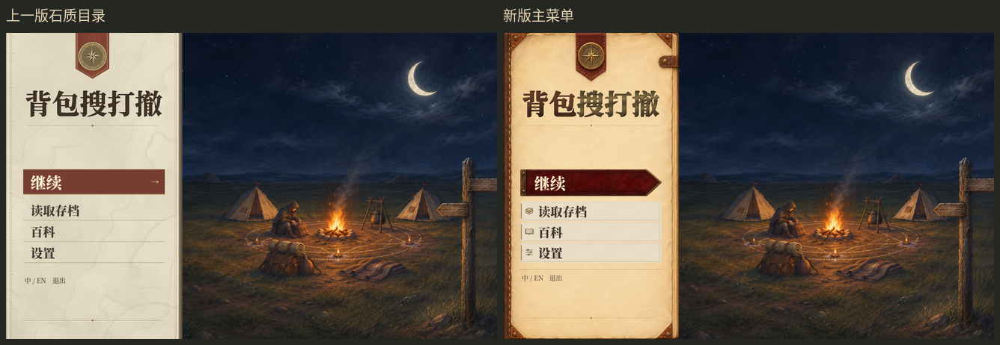
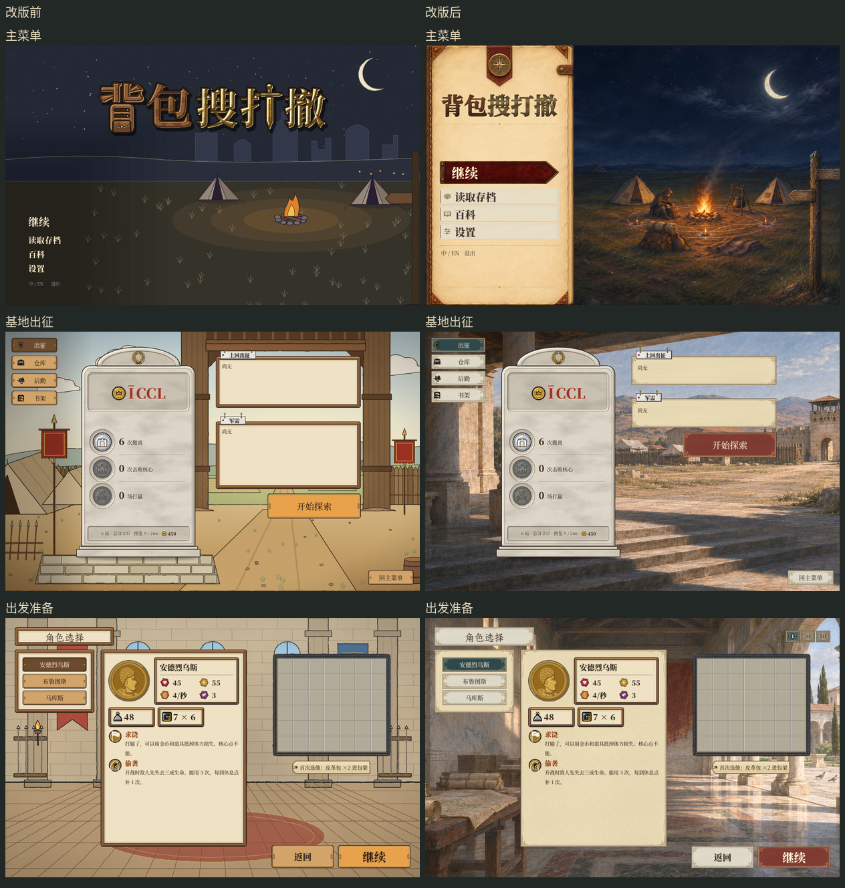
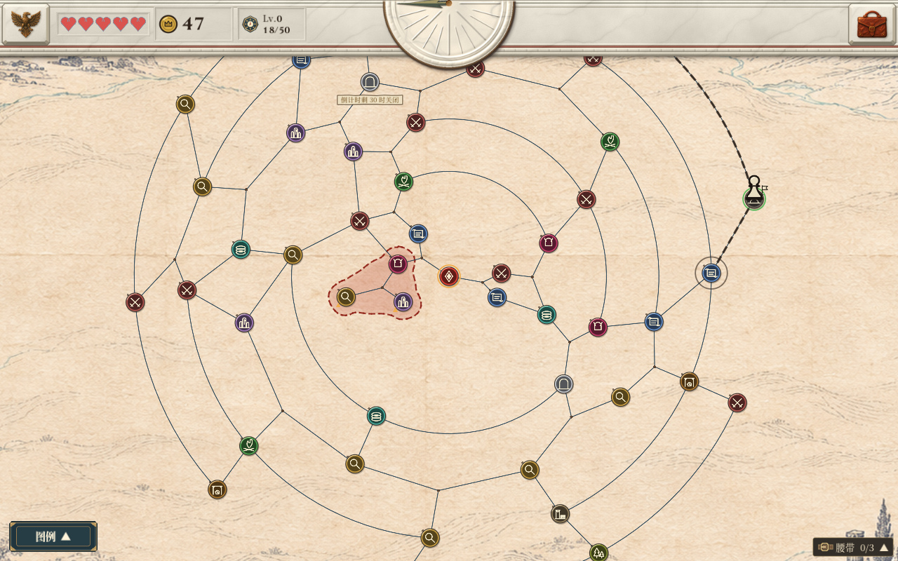
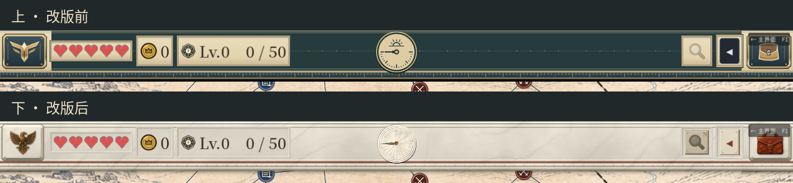
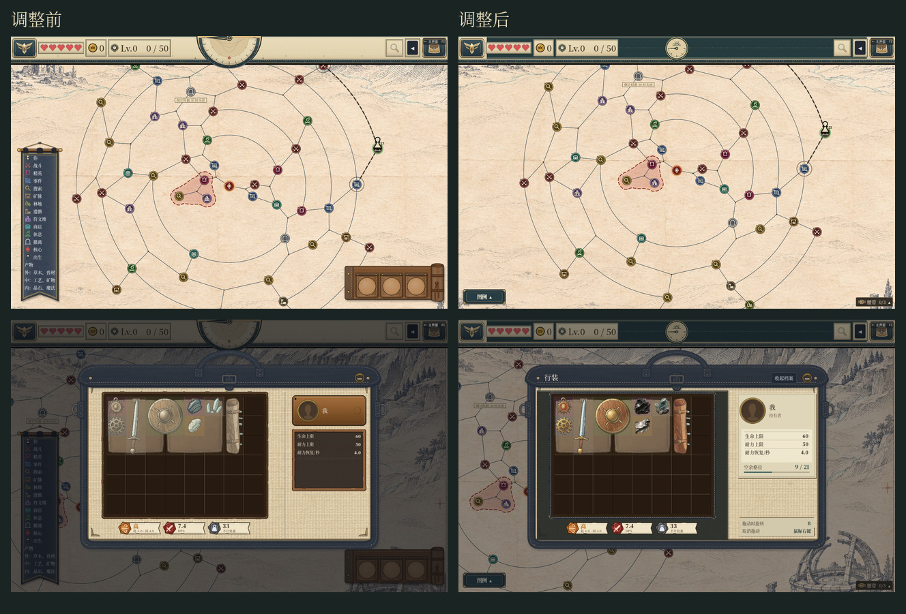

# 帝国边境测绘图册 · 美术交接与验收

打开游戏后，从主菜单进入自由探索，走入一张铜版测绘图，再打开随身背包。地图里的建筑、包里的旧物和撤离账单上的印章共同指向一个视角：玩家正在记录一次边境考察。画面深度来自纸张叠放、投影与局部压印，全部使用二维素材。

## 主菜单的行军登记簿

主操作使用带铜铆的红皮签。读取存档、百科和设置排成三枚有图标的索引，语言与退出放在页脚。纸面和缝线沿着边缘走，为中文与英文标题留出完整的字面。[主按钮四态](menu-button-input-states.jpg) · [中英文大字号与存档状态](menu-large-type-and-new-game.jpg) · [验收报告](../../docs/reports/testing/2026-11-19-menu-components.md)

## 主菜单、基地与节点搜索

主菜单左侧行军登记簿承载操作，右侧依次呈现边境夜营、军团登记口与灯下地图桌。夜营的帐篷和营火交代休息处，边营门边的账册交代登记用途，桌上的路线和行具交代出发准备。基地使用军营外廊和纸档，出征准备移入角色厅。墨绿标示已选项目，出征主键为朱红。[原定稿与本次重绘，上下对照](menu-originals-and-repaint.jpg) · [三张菜单实景](game-menu-three-landscapes.jpg) · [主菜单](game-field-guide-menu.jpg) · [基地](game-field-guide-camp.jpg) · [选角](game-field-guide-setup.jpg) · [英文大字号配装](game-preparation-large-en.jpg) · [科技成长](game-growth-large-zh.jpg)

存档夹按档位标明当前进度，设置页按宽度调整分组布局。对局记录分两行列出结果及时间、收获，实心星标出已收藏的场次。[存档](game-slots.jpg) · [设置](game-settings.jpg) · [对局记录](game-record-archive.jpg)

节点悬停先读地点名，搜索板把辨认进度与收获摆在一侧，行装摆在另一侧。收起后点棋子可以接续。[局内前后对照](field-guide-search-comparison.jpg) · [本轮测试记录](../../docs/reports/testing/2026-11-19-field-guide-ui.md)

## 当前顶栏 · 碑铭数字与独立半盘

[同一局的低数值、高数值原像素对照](topbar-fixed-readouts.png)。常规读数按可能显示的内容预留宽度。钱包保留四位数的位置，信仰为阶位、三位信力与三位阈值留位。体力按角色心数排布，中央留出盘面与阴影的完整宽度。右侧按钮各有热区，已有主动技能时预留技能位置。超过预留范围时，组件可扩展换行；窄槽中的长状态有摘要，悬停可看全文。

顶栏是一根有庞贝红饰线的平直石梁。下半圆是单独的部件，透明盘底、暗铜薄边与贴近盘缘的投影建立前后关系。盘面盖住中间一段檐线，两侧的檐线在同一高度。测试时移开日晷，后面露出整根直梁。

[同镜头显示与隐藏日晷](topbar-semidial-lintel-sections.png) · [玩家实机全图](game-map-lowered-semidial.jpg) · [上一版与本版](topbar-semidial-type-comparison.png)

金币与信力采用校样第三行的 Cinzel Bold 碑铭数字。同位数的金额或信力变动时，数字与相邻组件保持原位。中文状态使用思源宋体 Medium。点击角色脚下的节点可重开仍有内容的节点，键盘可按 N。[排印校样](semidial-type-study.png)

## 前一版顶栏 · 罗马大理石

横梁采用暖白大理石，浅灰矿脉跨过石面，庞贝红饰线下压一层细齿檐口。体力、钱币和信仰读数坐进浅凿槽。两端石键分别嵌鹰徽与行囊，受光边和按下深度随按钮状态变化。中央日晷的石盘固定，金属晷针随真实倒计时转动。将倒计时组件移出顶栏可查看同材质的小日规。

[当前完整地图](game-map-topbar-revision.jpg) · [运行环境与验收](../../docs/reports/testing/2026-11-19-marble-topbar.md)

## 探索与行装布局

- 探索界面将完整日晷收入顶栏。左下图例可展开，右下铜扣显示技能占用量；有技能时会直接显示可用图标。[上一版顶栏与探索布局](game-map-layout.jpg) · [同镜头展开](game-map-legend-open.jpg) · [大字号图例](game-map-key-large.jpg)
- 背包右栏是一张人物档案，显示属性、空余格位和拖动操作。只整理物品时可收起档案，棋盘停在原位。[展开](game-inventory-v3.jpg) · [收起](game-inventory-folded.jpg)
- 大字号分别验收中文和英文。两栏允许的宽度、关闭键与折叠开关按实际屏幕检查。[改版前](game-inventory-large-before.jpg) · [中文大字号](game-inventory-large.jpg) · [英文大字号](game-inventory-large-en.jpg)
- 同一配装中，第三版器物恢复各自材质的明暗，三件材料采用单独的透明栅格母版，其他五件保留矢量母版。[同配装材料对照](inventory-v2-v3.jpg)

[本轮验收报告](../../docs/reports/testing/2026-11-19-exploration-ui.md)

## 前一版 · 原画与实机记录

| 场景 | 在游戏中查看 | 验收图 |
|---|---|---|
| 主菜单 | 停在菜单，等背景轮播至测绘桌 | [测绘桌](game-menu.jpg) |
| 探索 | 在自由探索里缩放地图，对照路线、节点和底纹 | [玩家视角](game-map.jpg) · [全图](game-atlas.jpg) |
| 背包 | 打开背包，对照圆盾的盾面、剑刃和单格碎片 | [初版](game-inventory-before.jpg) · [修订版](game-inventory.jpg) · [实机局部对照](inventory-v1-v2.jpg) |
| 战斗 | 在开战后查看双方棋盘与状态栏 | [战斗实机](game-battle.jpg) |
| 撤离 | 成功撤离后等账单逐项显示完，观察标题右侧 | [落印后的账单](game-ledger.jpg) |

## 美术决策

- **地图**。遗迹用淡色纸本承载建筑线刻。林地、钟械、深处和军营各有单独底图。把高密度地标留在路线外围，用内深外亮的搪瓷节点和浅色图记标记交互位置。明底上画蓝墨线，暗底上画浅线。[五章图版](chapters.jpg)
- **随身器物**。圆盾、短剑、黄铜齿轮、太阳护符、工具卷与三件矿物分别靠轮廓、朝光面和材质辨认。地图的细排线缩到一格后容易糊成灰块，优先把线放在能交代形体的位置：盾缘顺弧、剑刃顺脊、裂石沿断面。布与皮革的缝线低于刃口反光的亮度。加入新物品时，先按实际格子缩小，与其余道具放在同一只包里检查，再验放大图。[首轮物品样张](items.png) · [第二版物品样张](items-engraved-v2.png) · [绘法对照](engraving-comparison.png)
- **器具与信仰**。顶栏采用黄铜仪表、纸面读数和深色端盖，六神使用六种独立剪影。战斗从开战快照取对应神徽，蛮神的不死事件在同侧已有蛮神条目时点亮双圈，悬停显示剩余秒数。旧磁盘回放缺少常驻快照时沿用原有战记。[仪表与神徽](hud.png) · [箱包与面板](surfaces.png)
- **状态与动画**。侵蚀用裂纹分叉表示风险，赐福用蜡印标记，拖动用 160 毫秒投影变化表现物品离开纸面。撤离落印发生在账单揭示之后。两处动画都读取游戏的动态效果设置，关闭后直接显示终态。[短剑的四种状态](item-states.png)

## 文件入口

| 以后要改什么 | 入口 |
|---|---|
| 章图、纸色与路线 | `assets/maps/`、`ui/map/map_view.gd` |
| 道具母版、运行时贴图 | `assets/items/survey-masters/`、`assets/items/`、`assets/items/@2x/` |
| 面板、菜单、仪表与神徽 | `assets/ui/board/`、`assets/ui/bag/`、`assets/ui/bronze/`、`assets/ui/menu/`、`assets/ui/hud/topbar/`、`assets/ui/faith/` |
| 背包手感与物品状态 | `ui/inventory/drag_layer.gd`、`item_painter.gd`、`inventory_view.gd`、`ground_layer.gd`（同目录） |
| 战斗神徽与结算落印 | `ui/battle/combatant_panel.gd`、`ui/battle/battle_view.gd`、`ui/game/result_screen.gd`、`assets/icon/expedition_seal.svg` |

[验收条件、测试结果与未覆盖项](../../docs/reports/testing/2026-11-19-art-atlas.md)
