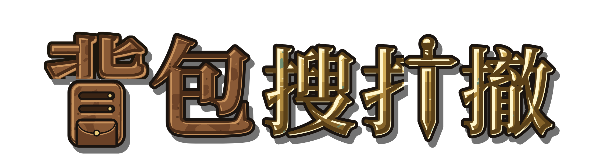

# 「背包搜打撤」中文字标美术总结

这组字标把玩法拆成了一个物件和三个动作。「背包」让人想到能装、能扣、能背走的行具；「搜打撤」把三个动作铸成一列，读到「打」时，字里恰好出现一把剑。这种读法来自画面和玩法的联系。项目定稿明确指定了两种材质，以及「背」和「打」的两处字形替换。[原始定稿说明](https://github.com/oZlUche/packsoudc/blob/e104f069/docs/reports/197-main-menu-and-title-brainstorm.md#L340)

## 「背包」：皮具的厚度来自边缘

「背」和「包」以栗褐色为主。浅驼色细边沿笔画转折走，字面上有不规则的深浅斑块，宽笔画的中央仍保留大片暗而平的面。「包」的外钩最容易看清这个做法：浅边顺着长弯兜到底，内侧压暗，像一条裁过、包过边的厚皮。定稿称之为“皮革缝线”；在菜单尺寸下，先看清的是连续的包边和圆厚转角，细小针脚较难辨认。

「背」的上半保留「北」，下半的「月」被改造成正面小背包。两条横向带子对应「月」里的两横，带端各有一颗亮钉，下面还有弧形袋盖和圆扣。视线远时，两横帮人认出「背」；靠近看，才读出扣件和外袋。「包」沿用同样的皮面，同时保留完整字形，稳住了这两个字的读音。

## 「搜打撤」：青铜的硬度来自切面

后三字以深褐铜边托住暖金色字面。窄而亮的浅金高光沿笔画一侧延伸，在尖角处折断；同一笔内相邻的亮面、暗面有清楚的分界，形成铸字倒角。少量灰绿色斑痕落在「搜」的竖笔和下方长捺等处。亮金仍占主导，所以远看更接近磨亮的铜件，近看才有旧化痕迹。

三个字都有左侧的「扌」，连续出现形成稳定节拍。「搜」和「撤」右半笔画密，居中的「打」最疏，给剑形留出了空间。圆形剑首、横向护手和向下收尖的剑身，占据了「丁」的位置。护手承担横笔，剑身承担竖向主笔，玩家能先读出动作，再发现兵器。

## 合在一起的效果

五个字共享厚重笔画、近黑外轮廓和向右下方偏移的投影，两种材质因此具有一致的厚度。皮面靠宽暗面和柔和包边塑形，铜面靠窄亮边和硬折面反光。整行读下来，前两字给出玩家带进场的东西，后三字给出进场后要做的事。

在实机轮播里，夜营的暗天空最能衬出金属亮边；地图桌上，右侧金字与羊皮纸色近，辨字更依赖深色外轮廓。缩小看仍容易认出的两处细节，是「背」的袋盖与「打」的剑尖。若以后再换画风，最值得延续的是**让物件承担笔画的功能**：先保证字能读，再让玩家从字里发现玩法。[三幅背景的实机对照](game-menu-three-landscapes.jpg)
