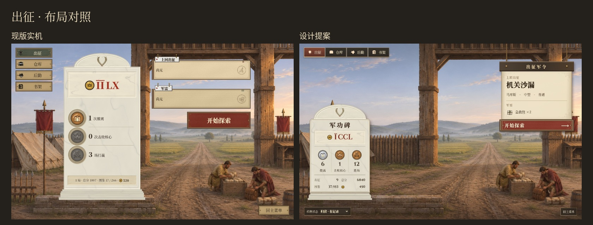

# 基地界面再设计 · 评审稿

[打开逐页评审台](index.html)。在仓库本地打开 HTML，点页名可切换地点，右上可以在现版实机与新布局之间原位切换。现版取自 `95ff38da` 的 Godot 截图；提案使用演示数据和项目素材。两侧适合比较布局与动作位置，数值不能用来比较游戏进度。

## 从旧稿里取回哪些决定

| 文档依据 | 作者最后选定的元素或行为 | 这次据此作出的设计选择 |
|---|---|---|
| [260 军功碑](../../docs/reports/260-records-board.md)、[264 基地](../../docs/reports/264-base-five.md)、[271 营门](../../docs/reports/271-cursor-press-and-expedition-scene.md) | 左碑右令、仓库估值与三枚累计奖章、清晨木门楼 | 把历史成绩压进单一碑形轮廓；右侧沿阅读顺序组织上次配置、本次军需、出发。中间留出看向营外的视线。 |
| [264 仓库工具](../../docs/reports/264-base-five.md)、[268 出售补充二](../../docs/reports/268-sell-into-market.md) | 包架贴仓库棋盘；筛选压暗原格；只勾选仓库里的物品 | 区分刚带回来和已经入库的物品。入库动作贴来源，筛选和出售贴目标，交易合计随选择变化。 |
| [261 书架](../../docs/reports/261-bookshelf-run-records.md)、[264 次级菜单](../../docs/reports/264-base-five.md) | 三列两层，五个入口，静物占一格；陈列随进度丰富 | 让实物承担分类，让进度摘要跟随当前陈列；保留熟手直接进入档案的路径。 |
| [262 后勤](../../docs/reports/262-logistics-tab.md)、[270 分摊](../../docs/reports/270-market-stalls.md) | 固定摊分类常备，散货摊可锁货和付费换货 | 按买东西的顺序安排选摊、认货、看价格；换货和锁定只归散货摊。 |
| [251 铁匠与集市 §10–13](../../docs/reports/251-base-market-smithy-sell-ratio.md) | 铁匠按大类找配方，选中后向下看材料和工钱；铁砧就是操作台，打造键为铁红 | 把选配方和决定是否打造画成前后相接的两步，选择改变时更新同一张工单。 |

## 五页图稿

[仓库实机与布局提案](warehouse-comparison.jpg)

| 地点 | 玩家此刻要回答的问题 | 图稿 |
|---|---|---|
| 出征 | 我带着什么出发？上次用了什么配置？ | [操作原型](expedition.html) · [整页图](expedition.jpg) |
| 仓库 | 哪些刚带回？哪些已入库、可以选来出售？ | [操作原型](warehouse.html) · [整页图](warehouse.jpg) |
| 书架 | 我想查的记录放在哪里？这格已经积累到什么程度？ | [操作原型](archive.html) · [整页图](archive.jpg) |
| 市场 | 这家铺子卖什么？这次花的钱买货还是换货？ | [操作原型](market.html) · [整页图](market.jpg) |
| 铁匠 | 这个配方现在能做吗？点打造会消耗什么？ | [操作原型](smithy.html) · [整页图](smithy.jpg) |

## 从图稿到游戏

先在 `MetaScreen` 和 `ExpeditionBoard` 中落实出征尺寸、键盘焦点与读数宽度。以初访无记录、归营有军需、中英文大字号三种画面校准。随后用仓库实物格检验带回背包、跨页筛选、勾选后改筛选、锁定与收藏的保护、确认取消。最后接书架与后勤，沿用现有档案、交易和锻造信号。原型中的样例值留在评审层，游戏继续从现有数据模型读数。

实装验收关注三个细节：切换数字记法时碑和导航保持原位；进入、取消出售时两边物品的归属仍清楚；鼠标和键盘从物品进入详情、再返回时能找回原来的物品。启用大字号时，说明区可以滚动，价格、工钱与最终动作需要同时可见。复核简中和英文，分别走首次进基地、满仓归营与材料不足的路径。

移植时要照顾两类现有玩家。试玩切片按 `SliceProfile.keeps_tab` 只展示出征和仓库；从老入口打开出售、科技或图鉴时，仍应进入对应的仓库状态或书架档案。记住玩家离开时的仓库页、筛选和选中格。出售前明确显示选中件数与所得，确认后再扣除；仓库放不下的物品继续留在带回棋盘上。

## 本轮查看方式与边界

五张整页图均以 Chromium 的 1280 × 800 视口绘出。评审台上方的「现版实机 / 设计提案」与样例状态选择器供评审使用。各页重点展示工作区，正式接回基地时四个一级入口应共用同一套位置、热区和焦点顺序，后勤再展开市场与铁匠。书架详情是档案摘要样张；跨页查看时演示存款、库存各自独立。构建游戏时以真实存档、业务校验和 Godot 布局测试复核。
